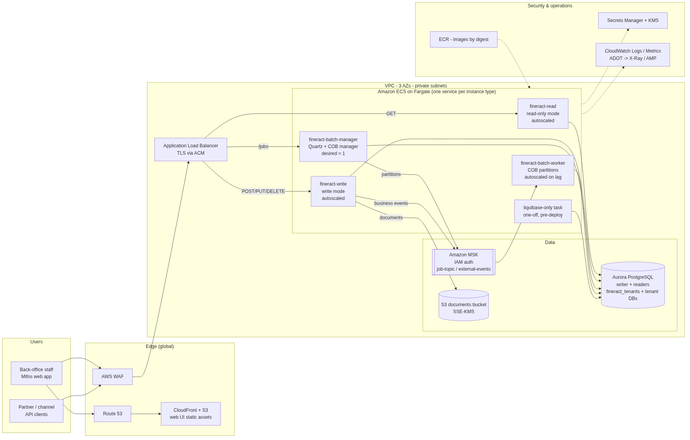
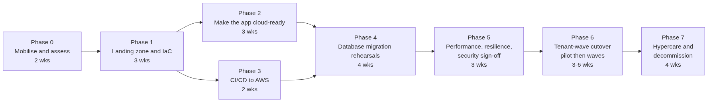
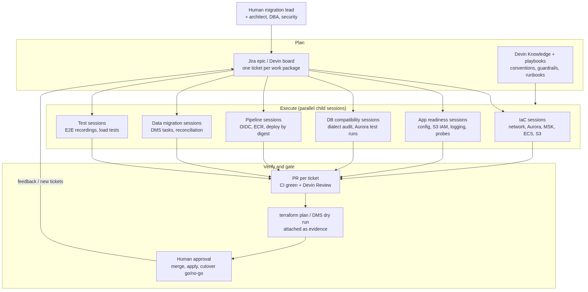

# Apache Fineract → AWS Migration Strategy

| | |
|---|---|
| **Scope** | Move this repository's application (Apache Fineract core banking platform, `develop` branch) from its current self-hosted / Docker Compose / manual Kubernetes footprint to a production-grade AWS deployment |
| **Audience** | Engineering leadership, cloud platform, DBA, security & risk, and the engineers who will run the programme |
| **Status** | Proposed strategy (v1). Facts about the application are taken from this repository and cited by path; facts about the customer's production estate (volumes, RTO/RPO, tenant count, approved AWS services) are marked as **assumptions** and listed in [§13 Open decisions](#13-open-decisions-and-assumptions) |
| **Companion diagrams** | [`diagrams/`](diagrams/) (PNG renders, Mermaid sources in `diagrams/src/`) |

---

## Contents

1. [Executive summary](#1-executive-summary)
2. [Goals, non-goals and success criteria](#2-goals-non-goals-and-success-criteria)
3. [Current state: what the repository tells us](#3-current-state-what-the-repository-tells-us)
4. [Migration approach (the "R" decision)](#4-migration-approach-the-r-decision)
5. [Target AWS architecture](#5-target-aws-architecture)
6. [Database migration strategy](#6-database-migration-strategy)
7. [Application changes required](#7-application-changes-required)
8. [CI/CD, infrastructure as code and environments](#8-cicd-infrastructure-as-code-and-environments)
9. [Security, compliance and resilience](#9-security-compliance-and-resilience)
10. [Testing and validation strategy](#10-testing-and-validation-strategy)
11. [Cutover, rollback and decommission](#11-cutover-rollback-and-decommission)
12. [Execution strategy with Devin](#12-execution-strategy-with-devin)
13. [Open decisions and assumptions](#13-open-decisions-and-assumptions)
14. [Risk register](#14-risk-register)
15. [Appendix A: configuration mapping (local → AWS)](#appendix-a-configuration-mapping-local--aws)
16. [Appendix B: repository evidence index](#appendix-b-repository-evidence-index)

---

## 1. Executive summary

Fineract is a stateless Spring Boot 3 / Java 21 service (`fineract-provider`) backed by a relational database with a **database-per-tenant** model, a Quartz + Spring Batch job layer (Close of Business, "COB"), optional messaging (JMS or Kafka) and a pluggable document store (local filesystem or S3). The codebase is already unusually cloud-ready:

* It ships its own container build (Jib, `fineract-provider/build.gradle`), health/readiness probes, Prometheus/OTLP/CloudWatch metrics export and JSON logging.
* It already contains AWS integrations: the AWS SDK v2 S3 client, Spring Cloud AWS, and **Amazon MSK IAM authentication** (`software.amazon.msk:aws-msk-iam-auth`), with a working MSK compose profile (`docker-compose-postgresql-kafka-msk.yml`, `config/docker/env/kafka-client-msk.env`).
* It supports **instance-type separation** (read / write / batch-manager / batch-worker) through `FINERACT_MODE_*` flags, which maps directly onto independently scaled AWS services.
* CI already runs the full integration suite on **MariaDB, MySQL and PostgreSQL** (`.github/workflows/build-*.yml`), so the database engine is a configuration choice, not a rewrite.

**Recommendation:** a **re-platform** ("lift, tinker and shift") to:

| Concern | Target |
|---|---|
| Compute | **Amazon ECS on AWS Fargate**, one service per Fineract instance type (EKS as the alternative if the customer already standardises on Kubernetes; the existing `kubernetes/` manifests are a starting point) |
| Database | **Amazon Aurora PostgreSQL** (Multi-AZ, reader endpoint wired to Fineract's read-only tenant connection), migrated tenant by tenant with **AWS DMS** full load + CDC |
| Messaging | **Amazon MSK** (IAM auth, already supported) for COB remote partitioning and external business events |
| Documents & report exports | **Amazon S3** with SSE-KMS; uses the task IAM role via the default credential chain (no code change) |
| Edge | Route 53 → AWS WAF → ALB (TLS via ACM); Mifos web UI on S3 + CloudFront |
| Secrets / keys | AWS Secrets Manager + KMS, injected as ECS secrets |
| Observability | CloudWatch Logs (JSON), CloudWatch / Amazon Managed Prometheus metrics, ADOT → X-Ray traces |
| Delivery | GitHub Actions with OIDC → ECR (Jib push, deploy by digest) → ECS blue/green; Terraform for all infrastructure |

Because tenants live in separate databases, the **cutover can be done tenant by tenant** (pilot tenant first, then waves), which keeps the blast radius small and gives a clean per-tenant rollback path.

**Execution with Devin** (detailed in [§12](#12-execution-strategy-with-devin)): the programme is broken into roughly 45–60 small, independently verifiable work packages (one ticket → one Devin session → one PR). Devin runs them in parallel waves (IaC modules, app-readiness changes, SQL dialect audit, pipelines, DMS tooling, reconciliation scripts, test automation, runbooks), with humans owning architecture decisions, approvals, `terraform apply` to shared/prod accounts and the cutover go/no-go. We estimate the end-to-end programme at **~6–7 months human-only vs ~3.5–4.5 months with Devin**, with the biggest savings in IaC authoring, dialect audit, test automation and reconciliation tooling.

---

## 2. Goals, non-goals and success criteria

### Goals

1. Run Fineract in AWS with **no loss of financial data** and **no change in accounting outcomes** (journal entries, loan schedules, balances identical before and after migration).
2. Highly available in one region (3 AZs), with a documented, tested DR posture.
3. Fully automated, auditable delivery (infrastructure and application) with no long-lived credentials.
4. Horizontal scale for read and write traffic and for COB batch processing.
5. Improve the security baseline (secrets out of config, encryption everywhere, least-privilege IAM).

### Non-goals (for this programme)

* Re-architecting Fineract into microservices or changing its domain logic.
* Changing the public REST API contract (`/fineract-provider/api/v1/...`). The repo already guards this with `verify-api-backward-compatibility.yml`.
* Multi-region active/active (designed for, not delivered; see [§9.4](#94-resilience-and-dr)).

### Success criteria (exit gates)

| # | Criterion | Measured by |
|---|---|---|
| S1 | 100% of tenants migrated, source decommissioned | Tenant register (`tenant_server_connections`) all pointing at Aurora |
| S2 | Zero reconciliation breaks per tenant | Row counts, checksums, trial balance and portfolio totals ([§6.6](#66-reconciliation-the-financial-acceptance-test)) |
| S3 | p95 API latency ≤ baseline and COB wall-clock ≤ baseline | Load test vs pre-migration baseline ([§10](#10-testing-and-validation-strategy)) |
| S4 | RPO ≤ 5 min, RTO ≤ 1 h in a DR game day (assumed targets) | DR test report |
| S5 | No static AWS keys or DB passwords in repo, images or task definitions | Secret scan + IaC policy checks |
| S6 | Every production change goes through the pipeline | CloudTrail / pipeline audit |

---

## 3. Current state: what the repository tells us

### 3.1 Application

| Aspect | Finding | Evidence |
|---|---|---|
| Runtime | Java 21, Spring Boot, embedded Tomcat on **8443 with TLS** (`server.ssl.enabled=true`, bundled `keystore.jks`), context path `/fineract-provider` | `fineract-provider/src/main/resources/application.properties` (server.* block) |
| Packaging | Spring Boot jar + Jib image `azul/zulu-openjdk-alpine:21`, runs as `nobody`, plugin classpath `/app/plugins/*`; a WAR build also exists (`fineract-war`) | `fineract-provider/build.gradle` (`jib {}`) |
| Modules | ~29 Gradle modules (loan, progressive-loan, savings, accounting, COB, investor, working-capital-loan…) | `settings.gradle` |
| API surface | ~169 `*ApiResource` classes, OpenAPI via springdoc | `find . -name "*ApiResource.java"` |
| Auth | HTTP Basic by default; OAuth2 (Spring Authorization Server) and 2FA optional | `fineract.security.*` in `application.properties` |
| Statelessness | No HTTP session state; caches are local Caffeine (`fineract.cache.*`) with short TTLs | `application.properties` |
| Health | `/actuator/health/liveness` and `/readiness` probes enabled; Prometheus endpoint exposed | `management.*` in `application.properties`; `kubernetes/fineract-server-deployment.yml` |
| Graceful shutdown | `server.shutdown=graceful`, 30 s phase timeout | `application.properties` |

### 3.2 Data

| Aspect | Finding | Evidence |
|---|---|---|
| Engines | MariaDB (default), MySQL and PostgreSQL all supported and CI-tested | `.github/workflows/build-mariadb.yml`, `build-mysql.yml`, `build-postgresql.yml`; README |
| Tenancy | A **tenant store** DB (`fineract_tenants`) holds `tenant_server_connections`; each tenant has its own DB/schema (`fineract_default`). Read-only replica connection fields exist per tenant | `db/changelog/tenant-store/parts/0004_readonly_database_connection.xml` |
| Schema management | Liquibase, two tiers (tenant-store and tenant), ~318 changelog files, runs at startup on write instances; a `liquibase-only` profile exists that runs migrations without starting the web server | `db/changelog/`, `application-liquibase-only.properties` |
| Liquibase safety | CI verifies backward compatibility of Liquibase changes | `.github/workflows/verify-liquibase-backward-compatibility.yml`, `liquibase-only-postgresql.yml` |
| Stored procedures | None found; DB-specific SQL is abstracted behind `DatabaseType` / dialect helpers | `fineract-core/.../database/DatabaseType.java` |
| User SQL in data | Stretchy reports and data tables are SQL stored **in the tenant DB**; these are not visible in the code and must be audited per tenant | `stretchy_report` table (runtime data) |
| Documents | Filesystem store under `${user.home}/.fineract` by default; S3 store available | `fineract.content.*`, `S3ContentStoreService.java`, `ContentS3Config.java` |

### 3.3 Batch, scheduling and messaging

| Aspect | Finding | Evidence |
|---|---|---|
| Scheduler | Quartz `SchedulerFactoryBean` with in-memory store; each job row carries a `node_id` and only runs on the matching `fineract.node-id` (or `0`) | `JobRegisterServiceImpl.java`, `ScheduledJobDetailRepository.java` |
| COB | Spring Batch **remote partitioning** (manager / worker), transport via Spring events (in-JVM), JMS or Kafka | `LoanCOBManagerConfiguration.java`, `LoanCOBWorkerConfiguration.java`, `fineract.remote-job-message-handler.*` |
| External events | Reliable event framework → JMS or Kafka (Avro schemas in `fineract-avro-schemas`) | `fineract.events.external.*` |
| Instance modes | Read / write / batch-manager / batch-worker toggles | `fineract.mode.*`; `fineract-doc/.../deployment/instance-type.adoc` |

### 3.4 Delivery and operations

| Aspect | Finding | Evidence |
|---|---|---|
| CI | GitHub Actions: build + sharded integration tests per DB engine, Cucumber E2E, Docker smoke, Sonar, API and Liquibase compatibility checks | `.github/workflows/` |
| CD | **None.** No workflow deploys anywhere. The only deployment path is manual `kubectl apply` (`kubernetes/kubectl-startup.sh`) with an in-cluster MySQL pod | `kubernetes/` |
| Config hygiene | Development env files contain literal DB passwords and the default tenant master password (`config/docker/env/fineract-common.env`, `fineract-postgresql.env`); `FINERACT_INSECURE_HTTP_CLIENT=true`; CORS `*` | `config/docker/env/` |
| Observability | Loki/Prometheus/Grafana/Tempo compose stack; CloudWatch metrics env profile exists | `config/docker/compose/observability.yml`, `config/docker/env/cloudwatch.env` |
| AWS docs | The project's own AWS deployment chapter is a placeholder ("TBD") | `fineract-doc/src/docs/en/chapters/deployment/aws.adoc` |

### 3.5 Implications

1. **No application rewrite is needed.** The work is configuration, infrastructure, delivery automation and data migration.
2. **The database migration is the critical path** and the main risk: it holds all financial state and is shared by every instance type.
3. **Quartz is not clustered**, so the batch-manager must be a singleton service (desired count 1) until/unless a JDBC job store is introduced.
4. **CD and IaC are net-new**, which makes them ideal parallel Devin work.

---

## 4. Migration approach (the "R" decision)

| Option | Description | Verdict |
|---|---|---|
| Rehost (EC2 lift-and-shift) | Run the jar/containers on EC2, DB on EC2 | Rejected: keeps undifferentiated ops (patching, DB HA, backups) |
| **Replatform** | Containers on managed compute, managed DB, managed messaging, S3 | **Recommended**: the app already supports every managed target through configuration |
| Refactor | Break into services, event-sourced ledger, serverless | Rejected for this programme: high risk on a core ledger, no business driver identified |
| Repurchase | Move to a SaaS core | Out of scope |

### 4.1 Compute: ECS Fargate vs EKS

| Criterion | ECS Fargate | EKS |
|---|---|---|
| Ops burden | Lowest (no nodes, no control-plane upgrades) | Higher (cluster upgrades, add-ons) |
| Fit with repo | Needs new task definitions | Existing `kubernetes/` manifests reusable (need hardening) |
| Batch workers | Service auto scaling on custom metrics (MSK lag) | KEDA on Kafka lag |
| Team skills | Lower bar | Requires Kubernetes skills |

**Default: ECS Fargate.** Choose EKS if the customer has an existing EKS platform team and guardrails; the rest of this strategy is unchanged either way.

### 4.2 Database: Aurora PostgreSQL vs Aurora MySQL

| Criterion | Aurora PostgreSQL | Aurora MySQL 8 |
|---|---|---|
| Source compatibility (MariaDB) | Heterogeneous; needs DMS type mapping and a dialect audit of tenant-stored SQL | Near-homogeneous; MariaDB-specific syntax still possible |
| Fineract upstream direction | Fully supported, CI-tested; README lists PostgreSQL ≥ 18 | CI-tested (`build-mysql.yml`), but not in the README's supported list |
| Ecosystem / features | Strong (Babelfish not needed; logical replication, pg_stat, IAM auth) | Strong |
| Engine version risk | **README requires PostgreSQL ≥ 18; confirm Aurora PostgreSQL major-version availability** (open decision D3). Fallback: RDS for PostgreSQL Multi-AZ cluster | MySQL 8.0 / 8.4 supported |

**Default: Aurora PostgreSQL**, provided an engine version that satisfies Fineract's requirement is available in the target region; otherwise RDS for PostgreSQL (Multi-AZ DB cluster) with a later move to Aurora. If the source is already PostgreSQL, the migration becomes homogeneous and much simpler.

---

## 5. Target AWS architecture



### 5.1 Service mapping

| Fineract component | AWS target | Notes |
|---|---|---|
| `fineract-provider` read traffic | ECS service `fineract-read` (`FINERACT_MODE_READ_ENABLED=true`, others false) | Uses the tenant **read-only** connection → Aurora reader endpoint. Auto scale on CPU / ALB request count |
| Write traffic | ECS service `fineract-write` | Only service allowed to receive events and (optionally) run Liquibase. Auto scale on CPU, min 2 tasks across AZs |
| Batch manager | ECS service `fineract-batch-manager`, **desired count 1**, deployment min 0% / max 100% | Quartz singleton; `FINERACT_NODE_ID` fixed; job API routed here |
| Batch workers | ECS service `fineract-batch-worker` | Consumes COB partitions from MSK; scale on consumer-group lag; `FINERACT_LIQUIBASE_ENABLED=false` (as in `fineract-worker.env`) |
| Schema migration | One-off ECS task with `SPRING_PROFILES_ACTIVE=liquibase-only` | Runs before each deploy; app services start with Liquibase disabled |
| Load balancing | ALB with listener rules: `GET` → read TG; mutating verbs → write TG; `/fineract-provider/api/v1/jobs*` and `/scheduler*` → batch-manager TG | `server.forward-headers-strategy=framework` already honours `X-Forwarded-*` |
| TLS | ACM certificate on ALB; ALB → task re-encrypts to 8443 with a keystore loaded from Secrets Manager, or plain HTTP inside the VPC if policy allows (`FINERACT_SERVER_SSL_ENABLED=false`) | Removes dependence on the bundled `keystore.jks` |
| Tenant store + tenant DBs | Aurora PostgreSQL cluster(s): writer + ≥1 reader per AZ | Option to shard large tenants onto dedicated clusters via `tenant_server_connections` |
| Messaging | Amazon MSK (provisioned or Serverless), IAM auth, topics `job-topic`, `external-events` | Configuration already proven in `kafka-client-msk.env`; set replicas to 3 |
| Documents | S3 bucket per environment, SSE-KMS, versioning, Object Lock (compliance mode) if regulation requires | `FINERACT_CONTENT_S3_ENABLED=true`, leave access/secret key empty → `DefaultCredentialsProvider` uses the task role |
| Report exports | S3 (`fineract.report.export.s3.*`) | Same IAM pattern via `AmazonS3Config` |
| Secrets | Secrets Manager (DB credentials with rotation, tenant master password, keystore, OAuth keys) | Injected via ECS `secrets`; never in task env plaintext |
| Images | ECR with scan on push, immutable tags | Jib pushes directly (`./gradlew :fineract-provider:jib`) |
| Logs | CloudWatch Logs via awslogs/FireLens, `FINERACT_LOGGING_JSON_ENABLED=true` | Tenant id already added by `TenantIdentifierLoggingConverter` |
| Metrics | CloudWatch (`FINERACT_MANAGEMENT_CLOUDWATCH_ENABLED=true`) or AMP via ADOT scraping `/actuator/prometheus` | |
| Traces | `management.tracing.enabled=true`, OTLP → ADOT sidecar → X-Ray | |
| Web UI | Mifos web app on S3 + CloudFront (separate repo; only its API base URL changes) | |
| Network | VPC, 3 AZs, private app and data subnets, NAT per AZ, VPC endpoints for S3, ECR, Secrets Manager, CloudWatch, STS | No public IPs on tasks |

### 5.2 Sizing starting point (to be validated by load test)

| Service | Task size | Min / max tasks |
|---|---|---|
| fineract-read | 2 vCPU / 4 GB | 2 / 10 |
| fineract-write | 2 vCPU / 4 GB | 2 / 8 |
| fineract-batch-manager | 2 vCPU / 4 GB | 1 / 1 |
| fineract-batch-worker | 2 vCPU / 4 GB | 0–2 / 20 (lag-driven, scale up before COB window) |
| Aurora | db.r7g.xlarge writer + 2 readers (prod) | Aurora auto scaling for readers |
| MSK | 3 brokers kafka.m7g.large (or MSK Serverless for non-prod) | |

JVM flags: drop the dev-only JDWP agent and `-XX:TieredStopAtLevel=1` from `fineract-common.env`; use `-XX:MaxRAMPercentage=75` and let container limits drive heap. Hikari pool sizes must be planned against Aurora `max_connections` × task count × tenants (each tenant has its own pool).

### 5.3 Account and environment layout

AWS Organizations / Control Tower landing zone with separate accounts: `shared-services` (ECR, CI roles), `dev`, `test` (SIT/UAT), `perf`, `prod`, `dr` (optional), `log-archive`, `security`. Same Terraform modules per account, different variable files.

---

## 6. Database migration strategy

### 6.1 Principles

* **Tenant is the unit of migration.** Each tenant DB is migrated, validated and cut over independently; the tenant store is updated last per tenant.
* **Liquibase owns the schema.** Target schemas are created by Fineract's own Liquibase (`liquibase-only` task) at the *same changelog version* as the source, not by DMS. DMS moves data only.
* **COB is the clock.** Cutover happens after a completed COB for that tenant and before the next business date starts.

### 6.2 Steps per tenant

1. **Pre-checks:** source Liquibase `DATABASECHANGELOG` head equals target build; no failed/stuck COB (`fineract.job.stuck-retry-threshold`); no loans locked by COB.
2. **Schema:** run the `liquibase-only` task against an empty Aurora database for the tenant.
3. **Full load + CDC:** AWS DMS task (MariaDB binlog → Aurora PostgreSQL), table mappings generated from the Liquibase schema; LOB mode set for document/blob columns; sequences reset after full load.
4. **Dialect audit of tenant-stored SQL:** extract every `stretchy_report` and data-table definition, run them against the Aurora copy, fix MariaDB-only syntax (`IFNULL`, `GROUP_CONCAT`, backtick identifiers, `LIMIT x,y`, date functions).
5. **Reconcile** while CDC is running ([§6.6](#66-reconciliation-the-financial-acceptance-test)).
6. **Cutover window:** freeze writes for the tenant (put write instances in read-only mode for that tenant or block at ALB/WAF by `Fineract-Platform-TenantId` header), wait for CDC lag = 0, final reconciliation, update `tenant_server_connections` (host, read-only host, credentials via Secrets Manager), resume.
7. **Reverse CDC** (Aurora → source) kept running for the rollback window.

### 6.3 Tenant store

Migrated once, early, as part of the pilot. Thereafter its rows are updated per tenant wave. Tenant passwords in `tenant_server_connections` are encrypted with the master password (`fineract.tenant.master-password`, `AES/CBC/PKCS5Padding`); the master password moves to Secrets Manager and is **rotated** at the end of the programme.

### 6.4 Documents

`aws s3 sync` from the filesystem store (`FINERACT_CONTENT_FILESYSTEM_ROOT_FOLDER`) to the S3 bucket preserving the key layout, followed by a checksum manifest comparison; delta sync at cutover.

### 6.5 Waves

| Wave | Tenants | Purpose |
|---|---|---|
| 0 | Synthetic tenant built from anonymised prod copy | Full dress rehearsal (×3 minimum) |
| 1 | 1 small, low-risk real tenant (pilot) | Prove the runbook in production |
| 2 | ~20% of tenants | Scale the runbook |
| 3..n | Remaining, largest last | Largest tenants may get dedicated Aurora clusters |

### 6.6 Reconciliation: the financial acceptance test

Automated per tenant, run at T-1 day, at cutover and at T+1 COB:

| Check | Method |
|---|---|
| Row counts | All tables, source vs target |
| Content checksums | Ordered hash per table chunk (primary-key ranges) for financial tables (`acc_gl_journal_entry`, `m_loan_transaction`, `m_savings_account_transaction`, `m_loan_repayment_schedule`, …) |
| Trial balance | Sum of debits/credits per GL account and office equals source |
| Portfolio | Outstanding principal / interest / fees per product, arrears buckets, savings balances |
| Behavioural | Run COB for the next business date in a cloned target and source; diff resulting journal entries |
| API parity | Same read API calls (clients, loans, schedules, GL) against old and new stacks; JSON diff ignoring volatile fields |

Any break blocks the tenant's cutover.

---

## 7. Application changes required

The strategy deliberately keeps code changes small. Expected changes, each a separate PR:

| # | Change | Type |
|---|---|---|
| A1 | Add an `aws` environment profile (env files / task definition templates) mirroring `config/docker/env/*` with Secrets Manager references and no literal secrets | Config |
| A2 | Remove literal credentials and the dev JDWP agent from shared env files; add secret scanning to CI | Config / CI |
| A3 | Enable JSON logging, CloudWatch/OTLP metrics and tracing in the AWS profile | Config |
| A4 | Switch documents and report exports to S3 using the default credential chain | Config |
| A5 | Make TLS keystore configurable from a mounted secret, or disable in-container TLS behind the ALB | Config (property already exists) |
| A6 | Liquibase as a pre-deploy task: app services run with `FINERACT_LIQUIBASE_ENABLED=false` | Config / deploy |
| A7 | Harden CORS (`FINERACT_SECURITY_CORS_ALLOWED_ORIGIN_PATTERNS`), enable HSTS, set `FINERACT_INSECURE_HTTP_CLIENT=false` | Config |
| A8 | Optional: Aurora IAM database authentication / Secrets Manager JDBC wrapper for rotated credentials | Small code + dependency |
| A9 | Optional (later): Quartz JDBC job store with clustering to remove the batch-manager singleton | Code |
| A10 | Fix any dialect issues found by running the integration suite against Aurora PostgreSQL | Code (expected small) |
| A11 | Fill `fineract-doc/.../deployment/aws.adoc` with the resulting deployment guide | Docs |

---

## 8. CI/CD, infrastructure as code and environments

### 8.1 Infrastructure as code

Terraform (or CDK if that is the customer standard) in this repository under `deploy/aws/` (or a sibling infra repo if mandated), organised as modules:

`network` · `aurora` · `msk` · `ecs-cluster` · `ecs-service` (reused ×4) · `alb` · `s3-documents` · `secrets` · `observability` · `dms` · `iam` · `waf` · `backup`.

Controls: remote state in S3 with DynamoDB locking, `tflint`, `checkov`/`tfsec`, `terraform plan` posted on every PR, apply only from the pipeline with environment approvals.

### 8.2 Application pipeline

```
PR:      build → unit tests → integration tests (existing sharded workflows) → Sonar → image build (Jib, not pushed)
merge:   Jib push to ECR (tag = git SHA, immutable) → SBOM + image scan
deploy:  dev (auto) → test (auto + E2E Cucumber suite) → perf (on demand) → prod (manual approval)
each env: run liquibase-only task (by digest) → ECS blue/green via CodeDeploy for read & write services
          → rolling (0/100) for batch-manager outside COB window → smoke tests (actuator health/info, login, read loan)
```

GitHub Actions authenticates to AWS with **OIDC** (no stored keys). Deployments reference image **digests**, not tags.

### 8.3 Environments

| Env | Purpose | Data |
|---|---|---|
| dev | Integration of IaC + app changes | Synthetic (default tenant) |
| test | SIT/UAT, E2E suite | Anonymised prod copy |
| perf | Load and COB benchmarks | Prod-sized anonymised copy |
| prod | Production | Real |
| dr | Optional warm standby | Aurora Global Database secondary |

---

## 9. Security, compliance and resilience

### 9.1 Identity and access

* One IAM task role per ECS service with least privilege (e.g. only the batch services can read/write the MSK job topic; only write can publish external events; only write can access the documents bucket).
* IAM Identity Center for humans; break-glass roles audited.
* Aurora: separate DB users for the app, DMS, read-only analysts; IAM auth where feasible.

### 9.2 Data protection

* KMS CMKs per data class (Aurora, S3, MSK, logs, secrets), key policies scoped to roles.
* TLS everywhere (ALB, ALB → task, JDBC `sslmode=verify-full`, MSK TLS + IAM).
* S3 Block Public Access, bucket policies denying non-TLS and non-KMS uploads.

### 9.3 Detection and governance

CloudTrail (org trail), AWS Config conformance packs, GuardDuty, Security Hub (FSBP + PCI DSS if applicable), Inspector for ECR images, WAF managed rules + rate limiting per tenant header, VPC Flow Logs. Data residency: pin region(s) per regulatory requirement.

### 9.4 Resilience and DR

| Layer | Within region | Cross region (if required) |
|---|---|---|
| Compute | Tasks spread over 3 AZs, ALB health checks on readiness probe | Pilot-light ECS services in DR region |
| Database | Aurora Multi-AZ, automated backups (35 days), PITR | Aurora Global Database (RPO ≈ 1 s typical, managed failover) |
| Messaging | MSK 3 AZ, RF 3, `min.insync.replicas=2` | MSK Replicator (external events only) |
| Documents | S3 (11 9s), versioning | S3 Cross-Region Replication |
| Config | Terraform + Secrets Manager replicas | Same modules applied in DR region |

COB resilience: because Quartz is in-memory and pinned to a node id, a batch-manager task replacement during COB aborts the in-flight run; Fineract's stuck-job retry (`fineract.job.stuck-retry-threshold`) and the loan-lock mechanism handle restart, but deployments of the batch-manager are **blocked during the COB window** by pipeline policy.

---

## 10. Testing and validation strategy

| Layer | What | Existing asset |
|---|---|---|
| Unit / integration | Full suite against **Aurora PostgreSQL** (not just Postgres in Docker) on a scheduled pipeline | `integration-tests/` (~274 test classes), sharded workflows |
| BDD E2E | Cucumber features (~70 `.feature` files incl. COB, loans, savings, accounting) against the deployed test env | `fineract-e2e-tests-core`, `fineract-e2e-tests-runner` |
| Messaging | Smoke test with MSK instead of local Kafka/ActiveMQ | `.github/workflows/smoke-messaging.yml` |
| API compatibility | Unchanged contract | `verify-api-backward-compatibility.yml` |
| Performance | Gatling/k6 scenarios for top API flows + COB benchmark on prod-sized data; compare with on-prem baseline | New |
| Resilience | AWS FIS experiments: kill tasks, fail over Aurora writer, broker loss, AZ impairment during COB | New |
| Security | DAST against test env, IAM Access Analyzer, pen test before prod | New |
| Data | Reconciliation suite ([§6.6](#66-reconciliation-the-financial-acceptance-test)) on every rehearsal | New |
| UAT | Business users run day-in-the-life scripts on the anonymised copy | New |

---

## 11. Cutover, rollback and decommission



### 11.1 Timeline (with Devin)

| Phase | Duration | Exit gate |
|---|---|---|
| 0. Mobilise & assess | 2 wks | Open decisions D1–D8 closed, baseline metrics captured |
| 1. Landing zone & IaC | 3 wks | dev + test environments created from Terraform |
| 2. Cloud-ready app (A1–A11) | 3 wks (parallel with 3) | App running in dev on Aurora/MSK/S3 |
| 3. CI/CD | 2 wks | Pipeline deploys by digest to dev/test |
| 4. DB migration rehearsals | 4 wks | 3 clean rehearsals, zero reconciliation breaks |
| 5. Perf, resilience, security | 3 wks | S3/S4 criteria met, pen test passed |
| 6. Tenant-wave cutover | 3–6 wks | All tenants live on AWS |
| 7. Hypercare & decommission | 4 wks | Source decommissioned, credentials rotated |

### 11.2 Cutover runbook (per wave, outline)

T-7d freeze non-essential changes · T-1d rehearsal reconciliation · T-0 after COB: block writes for wave tenants → CDC lag 0 → final reconciliation → switch `tenant_server_connections` → DNS/ALB routing for those tenants → smoke tests → unblock · T+1 COB on AWS, reconciliation of COB output · go/no-go to close rollback window.

### 11.3 Rollback

Per tenant, within the rollback window: block writes → reverse-CDC lag 0 → point `tenant_server_connections` back to the source → unblock. After the window closes (default: two successful COB cycles), rollback becomes a restore-from-backup exercise and is no longer a standard option.

### 11.4 Decommission

Final backups archived to S3 Glacier with retention per regulation, source DB servers and Kubernetes resources removed, DNS cleaned, credentials revoked, CMDB updated.

---

## 12. Execution strategy with Devin

This section describes how to run the migration **with Devin as the primary implementation workforce**, under human architectural control.

### 12.1 Operating model



| Role | Owned by | Responsibilities |
|---|---|---|
| Migration lead | Human | Scope, priorities, go/no-go, stakeholder comms |
| Cloud architect | Human | Target design decisions (D1–D8), reviews IaC PRs, approves `terraform apply` in shared accounts |
| DBA | Human | Approves DMS settings, reconciliation thresholds, cutover execution |
| Security | Human | IAM/KMS policy review, pen test, risk acceptance |
| **Devin (orchestrator session)** | Devin | Keeps the board current, splits epics into tickets, launches and monitors child sessions, consolidates status |
| **Devin (worker sessions)** | Devin | One ticket → one session → one PR with evidence (tests, `terraform plan`, recordings, reports) |
| **Devin Review** | Devin | Automated review on every PR before human review |
| App/platform engineers | Human | Review and merge PRs, pair with Devin on the hardest items |

Rules of engagement:

1. **Small, verifiable tickets.** Every ticket has acceptance criteria that can be checked by a command, a test, a `terraform plan` or a recording. Target size: one session, one PR, < ~400 changed lines.
2. **Devin never holds production credentials.** Devin works in this repo and in a **sandbox AWS account** through a scoped IAM role (create/destroy in `dev`/sandbox only). Shared and production accounts are changed only by the pipeline after human approval.
3. **Evidence on every PR**: CI green, `terraform plan` output, test logs, screenshots/recordings for UI-visible flows, reconciliation reports for data work.
4. **Repository conventions are encoded once** in Devin Knowledge / playbooks so every session follows them: PR title `FINERACT-<id>: …` (enforced by `pr-title-check.yml`), signed commits (`verify-commits.yml`), Spotless/Checkstyle, Liquibase backward-compatibility rules, no secrets in files.
5. **Humans decide; Devin proposes.** Architecture options are presented by Devin as short decision docs with a recommended default; the architect picks.

### 12.2 Environment preparation for Devin (week 1)

| Item | Detail |
|---|---|
| Devin environment blueprint | JDK 21 (Zulu), Gradle cache warm, Docker, MariaDB + PostgreSQL containers, Terraform, AWS CLI, `tflint`, `checkov`, DMS tooling, k6/Gatling |
| Integrations | GitHub (this repo), Jira/Linear for tickets, Slack/Teams for notifications, Datadog/CloudWatch MCP for observability, Sentry if used |
| AWS access | OIDC-federated role into the sandbox account; read-only role into `dev`/`test` for diagnostics |
| Knowledge | This strategy, target-architecture decisions, naming/tagging standards, cutover runbook template |
| Playbooks | `iac-module`, `app-config-change`, `dialect-fix`, `dms-task`, `reconciliation-check`, `e2e-recording`, `runbook-authoring` (one per repeatable work type, with verification checkpoints) |

### 12.3 Work breakdown and parallelism

Each row is a ticket family; numbers are approximate ticket counts. "Parallel" means the tickets in that family can run as simultaneous Devin sessions.

| Wave | Work package | Devin deliverable | Tickets | Parallel | Human gate | Evidence |
|---|---|---|---|---|---|---|
| W0 | Discovery & baseline | Config/env-var inventory, dependency and CVE report, SQL-dialect hotspot report, test-coverage map, baseline load test scripts | 5 | Yes | Architect sign-off | Reports in repo |
| W0 | Decision docs | One-page options + recommendation for D1–D8 | 8 | Yes | Architect decides | Decision records |
| W1 | Terraform modules | `network`, `aurora`, `msk`, `ecs-cluster`, `ecs-service`, `alb`, `s3-documents`, `secrets`, `observability`, `iam`, `waf`, `backup` | 12 | Yes | Cloud architect review | `terraform plan`, `checkov`, apply+destroy in sandbox |
| W1 | Environment composition | `dev`, `test`, `perf`, `prod` stacks wiring modules | 4 | After modules | Architect + security | Plan output |
| W2 | App readiness | A1–A8 from [§7](#7-application-changes-required) | 8 | Yes | Code owners | CI green, app boots in sandbox ECS |
| W2 | Dialect compatibility | Run integration shards against Aurora PostgreSQL; one ticket per failing area | 6–10 | Yes | Code owners | Green shard on Aurora |
| W3 | CI/CD | OIDC role, ECR push via Jib, liquibase-only task step, ECS blue/green deploy, smoke tests, env promotion, secret scanning | 7 | Mostly | Platform lead | Pipeline run logs |
| W4 | Data migration tooling | DMS task generator from Liquibase schema, LOB settings, sequence reset, reverse-CDC tasks, S3 document sync + manifest | 6 | Yes | DBA | Dry run on synthetic tenant |
| W4 | Reconciliation suite | Row counts, chunk checksums, trial balance, portfolio, COB diff, API parity diff | 6 | Yes | DBA + finance | Report on rehearsal |
| W4 | Tenant SQL audit | Extract and test stretchy reports / data tables per tenant, PRs or scripts to fix | per tenant | Yes | DBA | Pass/fail matrix |
| W5 | Testing | Load scenarios, FIS experiments, E2E Cucumber in `test`, recorded UI walkthroughs of key flows | 6 | Yes | QA lead | Reports, recordings |
| W6 | Runbooks | Cutover, rollback, DR failover, COB-window deploy policy, on-call guides | 5 | Yes | Migration lead | Reviewed docs, rehearsal notes |
| W6 | Cutover support | Per-wave checklist execution assistant, reconciliation runs, monitoring via MCP, incident triage | per wave | n/a | DBA executes | Wave reports |
| W7 | Hypercare & decommission | Alert triage, performance tuning PRs, decommission scripts, final docs (`aws.adoc`) | 5 | Yes | Migration lead | PRs |

Total: roughly **45–60 PRs** plus per-tenant audit and per-wave support sessions.

### 12.4 How a typical work package runs

```
1. Orchestrator files the ticket with acceptance criteria and links the relevant section of this doc.
2. A Devin worker session claims the ticket, reads Knowledge + playbook, and works on a fresh branch.
3. Devin implements, runs local verification (Gradle tests / terraform validate+plan / sandbox apply+destroy / DMS dry run).
4. Devin opens a PR with evidence attached; Devin Review runs; CI runs.
5. Devin fixes CI and review comments autonomously.
6. Human reviewer approves and merges (and, for infra, approves the pipeline apply).
7. Orchestrator updates the board, unblocks dependent tickets and launches the next sessions.
```

Example ticket prompts (abridged):

* *"Create Terraform module `deploy/aws/modules/aurora` for Aurora PostgreSQL: writer + N readers across 3 AZs, KMS CMK, parameter group with `rds.force_ssl=1`, Secrets Manager-managed master password with rotation, outputs for writer/reader endpoints. Acceptance: `terraform validate`, `tflint`, `checkov` clean; apply and destroy in sandbox; plan attached to PR."*
* *"Run the `test-core` integration shards from `build-postgresql.yml` against the sandbox Aurora PostgreSQL cluster. For each failing test, open one PR per root cause with the fix and a note on the dialect difference. Acceptance: shard green on Aurora and still green on MariaDB/PostgreSQL CI."*
* *"Write the reconciliation job for trial balance: for a given tenant and business date, compute sum(debit), sum(credit) per GL account and office on source and target; output a CSV and a non-zero exit code on any difference. Acceptance: passes on rehearsal tenant; deliberately corrupted row is detected."*

### 12.5 Parallel execution plan

| Week | Concurrent Devin sessions (approx.) | Focus |
|---|---|---|
| 1–2 | 6–10 | Discovery, decision docs, blueprint, playbooks |
| 3–5 | 12–15 | Terraform modules, app readiness, dialect audit |
| 6–8 | 10–12 | Pipelines, DMS tooling, reconciliation suite |
| 9–12 | 8–10 | Rehearsals support, tenant SQL audit, load/FIS tests |
| 13–15 | 4–6 | Security fixes, runbooks, perf tuning |
| 16+ | 2–4 per wave | Cutover support, hypercare, decommission |

### 12.6 Where Devin saves time (and where it doesn't)

| Area | Human-only estimate | With Devin | Why |
|---|---|---|---|
| IaC authoring (12 modules + 4 envs) | 6–8 wks | 2–3 wks | Parallel module sessions, plan/apply/destroy loop automated |
| App readiness + dialect fixes | 4–6 wks | 2–3 wks | Mechanical config changes, test-driven fix loop |
| CI/CD | 3–4 wks | 1.5–2 wks | Well-known patterns, quick iteration on workflow runs |
| Data tooling + reconciliation | 5–6 wks | 2–3 wks | Generated DMS mappings from schema, scripted checks |
| Testing (load, FIS, E2E) | 4–5 wks | 2–3 wks | Scenario authoring and recorded runs |
| Rehearsals, approvals, cutover | ~6–8 wks | ~5–7 wks | Bound by business calendar, COB windows and human sign-off |
| **Programme total** | **~6–7 months** | **~3.5–4.5 months** | |

Devin does not shorten: business sign-off, change-advisory approvals, regulator notifications, data-freeze windows, or the number of COB cycles you choose to observe before closing a rollback window.

### 12.7 Guardrails and quality controls

* **Branch protection** on `develop`/`main`: CI green, Devin Review, at least one human approval, code owners for `deploy/`, `db/changelog/`, security config.
* **Policy as code** in CI (`checkov`, OPA/Conftest) so non-compliant infra cannot merge regardless of author.
* **No destructive ops by Devin outside the sandbox**; DMS cutover steps are executed by the DBA from a runbook that Devin prepares and checks.
* **Audit trail**: every Devin session is linked from its PR and ticket; session logs retained.
* **Knowledge feedback loop**: any correction a reviewer makes twice becomes a Knowledge entry or playbook update, so later sessions stop repeating it.

### 12.8 Metrics for the Devin-assisted programme

PRs merged per week, PR cycle time, first-pass CI rate, review comments per PR, reconciliation breaks per rehearsal, tickets reopened, human review hours per PR. Reviewed weekly by the migration lead.

---

## 13. Open decisions and assumptions

| ID | Decision / assumption | Default proposed here | Owner |
|---|---|---|---|
| D1 | Compute platform | ECS Fargate | Cloud architect |
| D2 | Target database | Aurora PostgreSQL | Architect + DBA |
| D3 | PostgreSQL major version vs Fineract README (≥ 18) and Aurora availability | Use newest Aurora PG supported by both; else RDS for PostgreSQL | DBA |
| D4 | Current production source engine and version (MariaDB assumed) | MariaDB 11.x | DBA |
| D5 | Messaging for COB and events | MSK (IAM auth) | Architect |
| D6 | RTO / RPO, single vs multi-region | RPO ≤ 5 min, RTO ≤ 1 h, single region + backups | Business / risk |
| D7 | Approved AWS service list and landing-zone guardrails | As listed in §5 | Security |
| D8 | IaC tool and location (this repo vs infra repo) | Terraform in `deploy/aws/` | Platform lead |
| A1 | Tenant count, largest tenant size, daily transaction volume | Unknown; drives wave plan and sizing | Ops |
| A2 | Regulatory regime (PCI DSS, local banking regulator, data residency) | Unknown; drives region and controls | Compliance |
| A3 | Whether this repository is exactly what runs in production (forks, plugins under `/app/plugins`) | Assumed yes | Engineering |

---

## 14. Risk register

| # | Risk | Likelihood | Impact | Mitigation |
|---|---|---|---|---|
| R1 | Data mismatch after MariaDB → PostgreSQL conversion (decimal precision, dates/timezones, booleans, LOBs) | Medium | High | Liquibase-created target schema, DMS type mapping tests, chunk checksums, trial balance and COB diff per tenant |
| R2 | Tenant-stored report SQL is MariaDB-specific | High | Medium | Per-tenant extraction and test harness (W4), fixes before cutover |
| R3 | Aurora PostgreSQL major version lags Fineract's requirement | Medium | Medium | Decision D3 early; RDS PostgreSQL fallback |
| R4 | COB fails or runs longer on AWS | Medium | High | Perf environment COB benchmark, worker auto scaling, deploy freeze during COB window |
| R5 | Batch-manager singleton (in-memory Quartz) restarts mid-COB | Low | Medium | Desired count 1, no deploys in COB window, stuck-job retry, optional JDBC job store (A9) |
| R6 | Connection exhaustion (pool per tenant × tasks) | Medium | High | Pool sizing model, RDS Proxy evaluation, alarms on `DatabaseConnections` |
| R7 | Committed dev credentials reused in higher environments | Medium | High | A2, secret scanning, rotate everything at cutover |
| R8 | Latency for clients far from the AWS region | Low | Medium | Region choice, CloudFront for UI, connection reuse |
| R9 | Devin-produced change merged without adequate review | Low | High | Branch protection, code owners, policy as code, evidence requirement |
| R10 | Signed-commit and PR-title checks block automated PRs | High | Low | Configure Devin commit signing / ticket-ID convention in Knowledge from week 1 |

---

## Appendix A: configuration mapping (local → AWS)

| Setting | Local / compose value | AWS value |
|---|---|---|
| `FINERACT_HIKARI_JDBC_URL` | `jdbc:mariadb://db:3306/fineract_tenants` | `jdbc:postgresql://<aurora-writer>:5432/fineract_tenants?sslmode=verify-full` |
| `FINERACT_HIKARI_DRIVER_SOURCE_CLASS_NAME` | `org.mariadb.jdbc.Driver` | `org.postgresql.Driver` |
| `FINERACT_HIKARI_USERNAME` / `_PASSWORD` | literal in env file | ECS secret from Secrets Manager |
| `FINERACT_DEFAULT_TENANTDB_HOSTNAME` / `_RO_HOSTNAME` | `db` / empty | Aurora writer / reader endpoint |
| `FINERACT_DEFAULT_TENANTDB_MASTER_PASSWORD` | `fineract` | Secrets Manager (rotated) |
| `FINERACT_MODE_*` | all true | per service (see §5.1) |
| `FINERACT_NODE_ID` | 1 | batch-manager: fixed value; others: distinct |
| `FINERACT_LIQUIBASE_ENABLED` | true | false on services; true only in liquibase-only task |
| `FINERACT_SERVER_SSL_ENABLED` / keystore | true / bundled `keystore.jks` | ACM at ALB; keystore from secret or false inside VPC |
| `FINERACT_CONTENT_FILESYSTEM_ENABLED` | true | false |
| `FINERACT_CONTENT_S3_ENABLED` / `_BUCKET_NAME` / `_REGION` | false | true / env bucket / region; access & secret key **empty** (task role) |
| `FINERACT_REMOTE_JOB_MESSAGE_HANDLER_KAFKA_*` | disabled / localhost | enabled, MSK bootstrap, IAM SASL props (as `kafka-client-msk.env`), replicas 3 |
| `FINERACT_EXTERNAL_EVENTS_KAFKA_*` | disabled | enabled, MSK, IAM SASL |
| `FINERACT_LOGGING_JSON_ENABLED` | false | true |
| `FINERACT_MANAGEMENT_CLOUDWATCH_ENABLED` | false | true (or AMP via ADOT) |
| `FINERACT_MANAGEMENT_TRACIING_ENABLED` (sic) | false | true |
| `FINERACT_SECURITY_CORS_ALLOWED_ORIGIN_PATTERNS` | `*` | UI origin(s) only |
| `FINERACT_SECURITY_HSTS_ENABLED` | false | true |
| `FINERACT_INSECURE_HTTP_CLIENT` | true | false |
| `JAVA_TOOL_OPTIONS` | includes JDWP agent, `TieredStopAtLevel=1` | `-XX:MaxRAMPercentage=75 -XX:+UseContainerSupport` + required `--add-opens` |
| `AWS_ENDPOINT_URL` | `http://localstack:4666` | unset |

## Appendix B: repository evidence index

| Topic | Path |
|---|---|
| Main configuration | `fineract-provider/src/main/resources/application.properties` |
| Liquibase-only profile | `fineract-provider/src/main/resources/application-liquibase-only.properties` |
| Changelogs | `fineract-provider/src/main/resources/db/changelog/` |
| Container build | `fineract-provider/build.gradle` (`jib {}`) |
| Compose profiles | `docker-compose*.yml`, `config/docker/compose/`, `config/docker/env/` |
| MSK profile | `docker-compose-postgresql-kafka-msk.yml`, `config/docker/env/kafka-client-msk.env` |
| Kubernetes manifests | `kubernetes/` |
| S3 clients | `fineract-provider/.../core/config/ContentS3Config.java`, `.../s3/AmazonS3Config.java`, `fineract-document/.../S3ContentStoreService.java` |
| Scheduler | `fineract-provider/.../jobs/service/JobRegisterServiceImpl.java` |
| COB remote partitioning | `fineract-provider/.../cob/loan/LoanCOBManagerConfiguration.java`, `LoanCOBWorkerConfiguration.java` |
| Instance types | `fineract-doc/src/docs/en/chapters/deployment/instance-type.adoc` |
| Batch jobs | `fineract-doc/src/docs/en/chapters/architecture/batch-jobs.adoc` |
| CI workflows | `.github/workflows/` |
