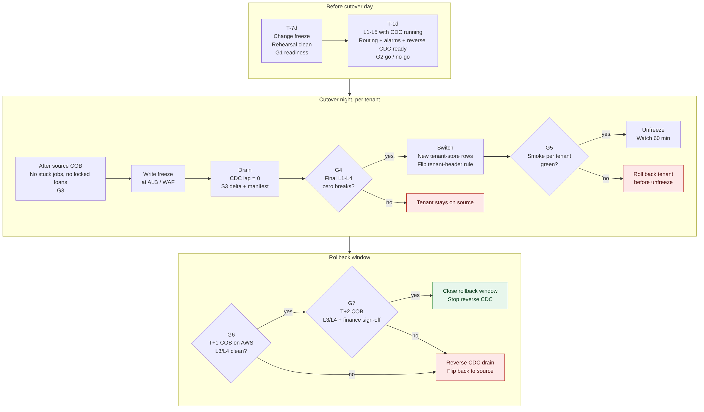
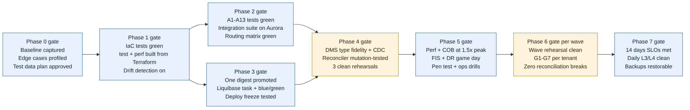

# Apache Fineract → AWS Migration: Testing and Validation Strategy

| | |
|---|---|
| **Scope** | Everything that must be tested, measured and signed off to move Fineract from its current footprint to the AWS target in the [migration strategy](README.md) with no financial discrepancy, no data loss and no unplanned outage |
| **Expands** | [Migration strategy §10](README.md#10-testing-and-validation-strategy) (testing), [§6.6](README.md#66-reconciliation-the-financial-acceptance-test) (reconciliation) and [§11](README.md#11-cutover-rollback-and-decommission) (cutover and rollback). Where this document and the strategy disagree, raise it as an open item in [§18](#18-open-items-and-assumptions) |
| **Audience** | Migration lead, QA lead, DBA, finance/operations sign-off owners, cloud platform, security, and the engineers (human and Devin) who build the test automation |
| **Status** | Proposed (v1). Repository facts are cited by path. Volumes, RTO/RPO, tenant counts and regulatory scope are **assumptions** inherited from the strategy's [§13](README.md#13-open-decisions-and-assumptions) |
| **Companion diagrams** | [`diagrams/testing-quality-gates.png`](diagrams/testing-quality-gates.png), [`diagrams/cutover-verification.png`](diagrams/cutover-verification.png) (Mermaid sources in `diagrams/src/`) |

---

## Contents

1. [What "flawless" means: measurable objectives](#1-what-flawless-means-measurable-objectives)
2. [Testing principles](#2-testing-principles)
3. [Risk-based coverage map](#3-risk-based-coverage-map)
4. [Test environments](#4-test-environments)
5. [Test data strategy](#5-test-data-strategy)
6. [Test streams](#6-test-streams)
7. [Data migration testing](#7-data-migration-testing)
8. [Reconciliation: the financial acceptance test](#8-reconciliation-the-financial-acceptance-test)
9. [Performance, capacity and COB testing](#9-performance-capacity-and-cob-testing)
10. [Resilience, chaos and disaster recovery testing](#10-resilience-chaos-and-disaster-recovery-testing)
11. [Security and compliance testing](#11-security-and-compliance-testing)
12. [Operational readiness testing](#12-operational-readiness-testing)
13. [Migration rehearsals (dress rehearsals)](#13-migration-rehearsals-dress-rehearsals)
14. [Cutover-day verification and go/no-go](#14-cutover-day-verification-and-gono-go)
15. [Rollback testing and triggers](#15-rollback-testing-and-triggers)
16. [Hypercare verification](#16-hypercare-verification)
17. [Quality gates, defect management and governance](#17-quality-gates-defect-management-and-governance)
18. [Open items and assumptions](#18-open-items-and-assumptions)
19. [Executing the test programme with Devin](#19-executing-the-test-programme-with-devin)
20. [Appendix A: smoke test catalogue](#appendix-a-smoke-test-catalogue)
21. [Appendix B: reconciliation query reference](#appendix-b-reconciliation-query-reference)
22. [Appendix C: AWS FIS experiment catalogue](#appendix-c-aws-fis-experiment-catalogue)
23. [Appendix D: go/no-go checklist (per wave)](#appendix-d-gono-go-checklist-per-wave)
24. [Appendix E: existing test assets in this repository](#appendix-e-existing-test-assets-in-this-repository)

---

## 1. What "flawless" means: measurable objectives

A flawless production execution is not "no bugs found". It is a set of objectives that are measured before, during and after every tenant cutover, with a gate that fails closed if any of them is not met.

| # | Objective | Target | How it is measured | Gate |
|---|---|---|---|---|
| Q1 | **Financial integrity** | Zero differences in trial balance, GL journal entries, loan and savings balances, schedules and arrears, per tenant | Reconciliation suite levels L1–L6 ([§8](#8-reconciliation-the-financial-acceptance-test)) at T-1, T-0 and T+1 COB, and T+2 COB before the rollback window closes | Any break blocks the tenant (no tolerance, no waivers) |
| Q2 | **No data loss** | 100% of rows, documents and images present and readable | Row counts + chunk checksums (L1/L2) and the document manifest ([§7.6](#76-document-and-image-migration-tests)) | Any missing object blocks the tenant |
| Q3 | **Behavioural equivalence** | Next-day COB on AWS produces the same journal entries, accruals, delinquency and schedules as the source | COB differential test (L5) on a cloned target and source | Any diff blocks the tenant |
| Q4 | **API equivalence** | Same responses to the same read calls, ignoring volatile fields | API parity diff (L6) | Any unexplained diff blocks the tenant |
| Q5 | **Availability during cutover** | Write freeze per tenant within the agreed window (assumed ≤ 60 min); zero read downtime for unmigrated tenants | Timed in each rehearsal; synthetic probes during cutover | Rehearsal must finish within 75% of the window |
| Q6 | **Performance** | p95 / p99 API latency ≤ baseline; COB wall-clock ≤ baseline; zero errors attributable to the platform at 1.5× peak | Load and COB benchmarks in `perf` against the recorded on-premises baseline ([§9](#9-performance-capacity-and-cob-testing)) | Strategy success criterion S3 |
| Q7 | **Resilience** | No data loss and automatic recovery for task, AZ, Aurora writer and broker failures; RPO ≤ 5 min, RTO ≤ 1 h (assumed, D6) | FIS experiments and DR game day ([§10](#10-resilience-chaos-and-disaster-recovery-testing)) | Strategy success criterion S4 |
| Q8 | **Security** | No critical/high findings open; no static credentials anywhere | DAST, pen test, IaC policy, secret scans ([§11](#11-security-and-compliance-testing)) | Strategy success criterion S5 |
| Q9 | **Operability** | Every P1 alert fires in test and reaches on-call; every runbook executed at least once by the people who will run it | Alert fire drills, runbook drills ([§12](#12-operational-readiness-testing)) | Operations sign-off |
| Q10 | **Reversibility** | Rollback of a tenant completes within the window and reconciles clean | Rollback rehearsed in every dress rehearsal ([§15](#15-rollback-testing-and-triggers)) | Rollback must be proven before wave 1 |

---

## 2. Testing principles

1. **The tenant is the unit of test, as it is the unit of migration.** Every gate is evaluated per tenant; a wave passes only when every tenant in it passes.
2. **Independent oracle for money.** Reconciliation computes totals directly from the source and target databases with SQL, never through the Fineract API being migrated, so a defect in the application cannot hide itself. API parity (L6) is a separate, additional check.
3. **Zero tolerance on financial data.** Monetary comparisons are exact at the stored scale (Fineract stores most amounts as `DECIMAL(19,6)` in its Liquibase changelogs); no rounding tolerance is configured. A difference is investigated, explained and fixed, then the full check is re-run.
4. **Production-like before production.** Every test that matters for cutover runs on the real AWS services (Aurora PostgreSQL, MSK, S3, ALB, ECS) with the production Terraform modules, not on Docker equivalents. Docker-based CI remains the fast inner loop.
5. **COB is the clock.** Business-date-sensitive tests control the Fineract business date (`/v1/businessdate`, `m_business_date`) explicitly; cutover verification always spans at least one real COB on AWS.
6. **Rehearse the exact runbook.** Dress rehearsals use the production runbook, tooling versions, people and timings. A rehearsal that needs an unscripted step fails and the runbook is updated.
7. **Evidence or it did not happen.** Every gate produces an artefact (report, log, recording, signed checklist) stored with the wave record. Absence of evidence is a failed gate.
8. **Fail closed, automate the gate.** Reconciliation and smoke suites exit non-zero on any break, and pipelines and cutover checklists cannot proceed past a failing step without an explicit, recorded go/no-go decision.
9. **Shift left.** Dialect, configuration and IaC defects are caught in CI on every PR; rehearsals should only discover issues in the data, the runbook and the timing.
10. **Test the rollback as hard as the roll-forward.** Reverse CDC, the tenant-header flip back and post-rollback reconciliation are first-class test cases, not appendices.

---

## 3. Risk-based coverage map

Each migration risk from the strategy's [risk register](README.md#14-risk-register), plus testing-specific risks identified here (T-prefixed), is mapped to the tests that retire it. A risk is closed for go-live only when every listed test has passed in the `perf` or rehearsal environment.

| Risk | Description | Retired by (section) |
|---|---|---|
| R1 | Data mismatch after MariaDB → PostgreSQL conversion | Type-mapping tests (§7.2), checksums L2 (§8), trial balance L3, portfolio L4, COB diff L5 |
| R2 | Tenant-stored report SQL is MariaDB-specific | Tenant SQL audit harness (§7.5) |
| R3 | Aurora PostgreSQL major version lags Fineract's requirement | Engine-version compatibility run (§6.3), full suite on the chosen engine |
| R4 | COB fails or runs longer on AWS | COB benchmark and parity (§9.4), COB-during-failure experiments (§10.1) |
| R5 | Batch-manager singleton restarts mid-COB | FIS experiment F3 (Appendix C), stuck-job retry test (§9.4) |
| R6 | Connection exhaustion (pool per tenant × tasks) | Connection-budget test (§9.3), alarm drill (§12) |
| R7 | Committed dev credentials reused in higher environments | Secret scans and image inspection (§11) |
| R8 | Latency for clients far from the region | Latency tests from client locations (§9.2) |
| R9 | Devin-produced change merged without adequate review | Quality gates (§17), PR evidence rules (§19) |
| R10 | Signed-commit and PR-title checks block automated PRs | Pipeline dry run in week 1 (§19) |
| T1 | Edge routing sends a tenant or endpoint to the wrong fleet | ALB routing matrix test (§6.5), per-tenant canary (§14) |
| T2 | Tenant-store row or cached pool points at the wrong database | Tenant-store verification (§6.6), pool-cache test after A13 or restart (§6.6) |
| T3 | Documents unreadable after S3 move (key prefix, IAM) | Document manifest and resolve tests (§7.6), IAM negative tests (§11) |
| T4 | CDC drops, duplicates or reorders changes under load | CDC-under-load test (§7.3), L1/L2 during CDC |
| T5 | Sequences/identity values collide after full load | Sequence-reset test (§7.4) |
| T6 | Timezone or business-date drift (DB vs JVM vs tenant timezone) | Timezone tests (§7.2), COB diff L5 |
| T7 | External events lost, duplicated or out of order on MSK | Messaging tests (§6.7) |
| T8 | Test environment differs from production (config drift) | Same Terraform modules, drift detection, config diff (§4.2) |
| T9 | Masked test data hides edge cases present in production | Data profiling and edge-case catalogue (§5.3) |
| T10 | Reverse CDC not viable when rollback is needed | Rollback in every rehearsal (§15) |
| T11 | Alerting gaps mean a silent failure after cutover | Alert fire drills (§12), hypercare checks (§16) |
| T12 | Stale caches (Caffeine, tenant pools) serve old data after cutover | Post-cutover cache tests (§6.6) |

---

## 4. Test environments

### 4.1 Environment matrix

Environments are those of the strategy's [§8.3](README.md#83-environments), each built from the same Terraform modules with different variable files.

| Env | Purpose in testing | Data | Fidelity to prod | Who runs what |
|---|---|---|---|---|
| CI (GitHub Actions) | Every PR: build, unit, integration shards on MariaDB/MySQL/PostgreSQL, Cucumber, API and Liquibase compatibility, IaC static checks | Synthetic (default tenant) | Low (Docker) | Automated |
| sandbox | Devin and engineers: Terraform apply/destroy, DMS dry runs, harness development | Synthetic | Medium (real services, small sizes) | Devin, engineers |
| dev | First deployment of each change; smoke and E2E on real AWS services | Synthetic | Medium | Pipeline |
| test (SIT/UAT) | E2E Cucumber suite, integration suite against Aurora, messaging on MSK, UAT, security DAST | Anonymised prod copy | High (prod topology, smaller sizes) | Pipeline, QA, business |
| perf | Load, soak, COB benchmark, FIS experiments, dress rehearsals | Prod-sized anonymised copy | Highest (prod sizes and topology) | QA, platform, DBA |
| prod | Pilot tenant and waves; synthetic probes and read-only verification | Real | — | DBA executes, Devin assists |
| dr (optional) | DR game day | Aurora Global Database secondary | Same modules | Platform |
| source-replica | A restored copy of the current production source, used as the "before" side for rehearsal reconciliation and COB diffs | Anonymised copy at the same point in time as `perf` | Same engine/version as source (D4) | DBA |

### 4.2 Environment parity controls

* **Same code, same modules:** each environment is a Terraform composition of the same modules; differences are limited to variables (sizes, counts, CIDRs, account IDs). A CI check diffs the variable files against an allow-list of variables that may differ.
* **Same image digest:** the pipeline promotes one image digest through dev → test → perf → prod; tests record the digest they ran against.
* **Configuration diff report:** before each rehearsal and wave, a script dumps the effective `FINERACT_*` environment of every ECS service (secrets redacted) in `perf` and `prod` and diffs them. Expected differences are listed; anything else blocks.
* **Drift detection:** scheduled `terraform plan` on every environment; non-empty plan raises an alert.
* **Engine parity:** Aurora engine version and parameter group are identical in `test`, `perf` and `prod`.

---

## 5. Test data strategy

### 5.1 Data sets

| Data set | Built from | Used for |
|---|---|---|
| D-SYN | Fineract's default tenant plus scripted products, clients, loans and savings created through the API (the Cucumber suites already do this) | CI, dev, functional E2E |
| D-EDGE | Hand-built tenant covering every product/feature combination in the edge-case catalogue (§5.3) | Type-mapping tests, COB diff, API parity, regression of known defects |
| D-ANON | Anonymised copy of a representative production tenant | test env, UAT, rehearsal 1 and 2 |
| D-FULL | Anonymised copy of **all** production tenants, prod-sized | perf env, load/COB benchmarks, rehearsal 3+ |
| D-BASE | Captured production metrics, request logs and COB timings (no customer data) | Workload model and performance baselines |

### 5.2 Anonymisation rules

* Mask personally identifiable data (names, national IDs, phone numbers, emails, addresses, dates of birth, bank account numbers, document contents and images) deterministically, so joins and uniqueness are preserved.
* **Never alter financial columns** (amounts, dates, statuses, GL accounts, product configuration, schedules): reconciliation and COB diff need real distributions and real edge cases.
* Replace documents and images with placeholder files of the **same size and MIME type**, keeping their stored locations, so S3 migration volumes and paths are realistic.
* Run a post-masking scan (regex and dictionary checks for real names, ID formats, emails) and record the result; a failed scan blocks the data set's release.
* Data masking is executed by the DBA in the source estate; Devin builds and tests the masking scripts against D-EDGE only.

### 5.3 Edge-case catalogue

Profile production (counts only, no customer data) and make sure every item below exists in D-EDGE and, by query, in D-ANON / D-FULL. Missing items are created synthetically.

| Area | Edge cases to include |
|---|---|
| Monetary values | Maximum-precision amounts (6 decimals), zero and negative adjustments, very large balances, multi-currency, currencies with 0 and 3 decimal places |
| Dates and time | Leap days, month-end and year-end, DST transitions in the tenant timezone, tenant timezones far from UTC (CI uses `Asia/Kolkata` in `liquibase-only-postgresql.yml`), business date ≠ system date |
| Loans | Every product type in use (standard, progressive, working-capital), multi-tranche, re-aged, re-amortized, rescheduled, charged-off, written-off, closed-obligations-met, overpaid, chargeback, interest pause, floating rates, advanced payment allocation, down payment, capitalized income, buy-down fees |
| Savings | Fixed/recurring deposits, dormant, blocked, overdraft, interest posting at period end, holds and lien |
| Accounting | Manual journal entries, reversals, accruals, periodic and cash accounting, closures (`acc_gl_closure`), provisioning |
| Text and binary | Unicode (non-Latin scripts, emoji) in names and notes, very long notes, trailing spaces, empty strings vs NULL, binary/LOB columns, documents > 100 MB if they exist |
| Configuration | Data tables (`x_registered_table`) with every column type, custom stretchy reports, maker-checker enabled permissions, hooks, SMS/email campaigns, scheduled jobs with non-default schedules |
| Locks and in-flight state | Loans locked by COB (`m_loan_account_locks`), pending maker-checker commands, failed jobs, idempotency records |

### 5.4 Data refresh and lifecycle

* D-ANON and D-FULL are refreshed before each dress rehearsal so the rehearsal reflects current schema (Liquibase head) and data shape.
* Every data set is versioned (source snapshot time, masking script version, Liquibase head) and its version is recorded in every test report that used it.
* Test data sets are encrypted with the environment's KMS keys and deleted when the environment is torn down.

---

## 6. Test streams

Each stream lists scope, existing assets, new work, and its exit criterion. Streams run in parallel; their exit criteria feed the phase gates in [§17](#17-quality-gates-defect-management-and-governance).

### 6.1 Infrastructure-as-code tests

| Test | Tooling | When | Pass criterion |
|---|---|---|---|
| Format, validate, lint | `terraform fmt -check`, `terraform validate`, `tflint` | Every PR | Clean |
| Policy as code | `checkov` / `tfsec`, OPA/Conftest rules for org guardrails (encryption, no public IPs, tagging, KMS, TLS-only bucket policies) | Every PR | No failed policy without a recorded, approved exception |
| Plan review | `terraform plan` posted to PR | Every PR | Reviewed; no unexpected destroys on stateful resources (Aurora, S3, MSK, KMS) |
| Module integration tests | Terratest (or `terraform test`) apply + assertions + destroy in sandbox: e.g. Aurora has `rds.force_ssl=1`, S3 Block Public Access, tasks have no public IP, VPC endpoints resolve privately | Every module PR, nightly | All assertions pass, destroy succeeds |
| Environment build from scratch | Apply the full `dev` composition into an empty account | Weekly until Phase 3, then before each rehearsal | Environment healthy end-to-end; time to build recorded |
| Drift detection | Scheduled `terraform plan` | Daily on all envs | Empty plan |

**Exit:** all modules pass integration tests; `test` and `perf` are built only from Terraform; drift detection running.

### 6.2 Build, unit and component tests (existing)

The existing CI is the first safety net and remains mandatory on every PR, including migration PRs:

* `build-mariadb.yml`, `build-mysql.yml`, `build-postgresql.yml`: build and five integration shards (`test-core-1` … `test-core-5`) per engine.
* `build-cucumber.yml`: module-level Cucumber features (for example under `fineract-provider/src/test/resources/features/`, including COB, batch and infrastructure features) and the progressive-loan embeddable generator tests.
* `run-integration-test-sequentially-postgresql.yml`: full sequential run including `twofactor-tests` and `oauth2-tests`.
* `sonarqube.yml`, `verify-commits.yml`, `pr-title-check.yml`.

**New:** none required for the migration itself, but any code change from the strategy's [§7](README.md#7-application-changes-required) (A8, A9, A12, A13) must add unit and integration tests in the module it touches (see §6.4).

**Exit:** all existing workflows green on the release candidate.

### 6.3 Database engine compatibility tests

The integration suite already passes on Docker PostgreSQL in CI. The migration adds the managed engine and its parameter group as the target.

| Test | How | Pass criterion |
|---|---|---|
| Integration suite on Aurora | Run the five `test-core-*` shards and the sequential job against an Aurora PostgreSQL cluster in `test`, pointing `integration-tests` at a Fineract deployed in `test` on Aurora, from a runner inside the VPC. Both client paths must be redirected: `-Dfineract.it.url=...` for the generated client (`FineractClientHelper`) **and** the `BACKEND_PROTOCOL`, `BACKEND_HOST` and `BACKEND_PORT` environment variables read by `ConfigProperties.Backend` for the RestAssured tests (`Utils`). `-PdbType=postgresql` alone is not enough: the Cargo-launched server in `integration-tests/build.gradle` hardcodes `localhost:5432`, so either parameterise those JDBC/tenant properties or test the deployed service. Guard: the run fails if `/actuator/info` on the target does not report the `test` environment's image digest | 100% pass, same skip list as CI |
| Engine version | Run the suite on the exact Aurora (or RDS) PostgreSQL major/minor chosen in D3 | 100% pass |
| Liquibase from empty | `liquibase-only` profile against an empty Aurora tenant store and tenant DB (mirrors `liquibase-only-postgresql.yml`) | Completes; `DATABASECHANGELOG` head equals the build's head |
| Liquibase upgrade path | Apply the **source production** Liquibase head to an empty Aurora DB, then upgrade to the release candidate (mirrors `verify-liquibase-backward-compatibility.yml`) | No failures; schema diff vs fresh install is empty |
| Schema equivalence | Compare the schema produced by Liquibase on Aurora with the schema of the source DB after its own Liquibase run: tables, columns, nullability, defaults, indexes, constraints (engine-specific type names normalised) | Only documented, expected engine differences |
| Parameter-group behaviour | Targeted tests for settings that change semantics: `timezone`, `DateStyle`, `standard_conforming_strings`, collation/case sensitivity of `LIKE` and `ORDER BY` on text columns, `max_connections`, `statement_timeout`, `idle_in_transaction_session_timeout`, `rds.force_ssl` | Behaviour matches the Docker PostgreSQL CI baseline |
| TLS to database | Connect with `sslmode=verify-full` and the RDS CA bundle; negative test with a wrong host name | Positive succeeds, negative fails |
| Read replica routing | With a tenant read-only connection configured (`tenant_server_connections` read-only fields), confirm read-mode tasks query the reader endpoint and write-mode tasks the writer (Performance Insights / `pg_stat_activity` by host) | Reads on reader only; no writes attempted on reader |
| Replica lag behaviour | Inject replica lag (heavy write load) and check read-after-write flows that the UI relies on | Documented behaviour; any flow that requires read-your-writes is routed to write or accepted by the business |

**Exit:** integration suite 100% green on the target engine and parameter group; schema equivalence report signed by the DBA.

### 6.4 Application-readiness change tests (A1–A13)

Every change from the strategy's [§7](README.md#7-application-changes-required) ships with a specific test.

| Change | Test that proves it |
|---|---|
| A1 `aws` profile | Task definitions render with every required `FINERACT_*` variable; a contract test fails if a variable used in `application.properties` has no value or default in the AWS profile |
| A2 credentials out of env files | Secret scan (gitleaks/trufflehog) on repo and on built image layers finds nothing; container starts with secrets only from Secrets Manager |
| A3 logging/metrics/tracing | JSON log lines parse and contain the tenant id; metrics visible in CloudWatch/AMP; one request traced end-to-end in X-Ray (ALB → task → JDBC) |
| A4 S3 documents/report exports | Upload, download, delete a document and an image; run a report export; all with access/secret keys empty (task role) |
| A5 TLS | ALB → task over 8443 with keystore from secret, or plain HTTP with `FINERACT_SERVER_SSL_ENABLED=false`; health checks pass; TLS policy scan on ALB |
| A6 Liquibase pre-deploy task | App services start with `FINERACT_LIQUIBASE_ENABLED=false` and fail fast if the schema is behind; liquibase-only task is idempotent when re-run |
| A7 CORS/HSTS/insecure client | CORS preflight from an unlisted origin is rejected; HSTS header present; outbound TLS to a self-signed endpoint fails |
| A8 IAM DB auth / Secrets Manager JDBC | Credential rotation during a load test causes zero failed requests |
| A9 Quartz JDBC store (if done) | Two batch-manager tasks; kill the active one mid-job; the job runs exactly once |
| A10 dialect fixes | Each fix adds an integration test that fails on the old code against PostgreSQL and passes on MariaDB, MySQL and PostgreSQL |
| A11 docs | Doc build (`build-documentation.yml`) green; a reviewer follows the guide to deploy `dev` |
| A12 S3 tenant prefix | Two tenants upload documents with the same relative location; each downloads only its own; delete affects only its own; keys in S3 start with the tenant identifier |
| A13 pool eviction (if done) | Change a tenant's connection row; next request uses the new DB without restart; old pool closed |

### 6.5 Edge routing and instance-mode tests

The ALB rules in the strategy's [§5.1](README.md#51-service-mapping) are the most error-prone configuration in the design. They get a dedicated, automated routing matrix test that runs after every ALB change and at every cutover.

| Request | Expected target |
|---|---|
| `GET/POST/PUT/DELETE /fineract-provider/api/v1/jobs*` | batch-manager |
| `* /fineract-provider/api/v1/scheduler*` | batch-manager |
| `POST /fineract-provider/api/v1/loans/catch-up*`, `GET .../loans/is-catch-up-running*` | batch-manager |
| Any other `GET` | read |
| `POST/PUT/DELETE/PATCH` (non-batch paths) | write |
| `POST /fineract-provider/api/v1/batches` (Batch API) | write |
| Any request with `Fineract-Platform-TenantId` of an **unmigrated** tenant | source fleet (all paths) |
| Any request with the tenant header of a **migrated** tenant | AWS fleet per rules above |
| Missing or unknown tenant header | Defined behaviour (reject or default), identical on both fleets |
| Mutating request for a tenant **in its write freeze** | Blocked at ALB/WAF with the agreed status; reads still served |

How: each target group's tasks expose their instance mode (`/actuator/info` or a response header added at the ALB); the test sends each request and asserts the target. Also run the existing `InstanceModeIntegrationTest` and `LoanCOBCatchUpInstanceModeIntegrationTest` against the per-mode services to confirm `FineractInstanceModeApiFilter` rejects requests that reach the wrong mode.

**Production safety:** in `prod` only the `GET` rows are executed. Mutating rows are proven in `test` and `perf`, and in `prod` by (a) an automated diff showing the production listener rules, priorities and conditions are identical to the tested ones (only hostnames/ARNs differ), and (b) the write-freeze row, sent before unfreeze to a designated test tenant, where the ALB/WAF rule rejects the request before it reaches Fineract. No probe may create, change or delete production data or trigger jobs.

**Exit:** 100% of routing matrix rows pass in `test` and `perf`; in `prod` (pre-wave), all `GET` rows pass, the rule diff is clean and the write-freeze probe is rejected.

### 6.6 Multi-tenancy, tenant store and cache tests

| Test | Pass criterion |
|---|---|
| Tenant isolation: two tenants with overlapping IDs; every read/write for tenant A never touches tenant B's DB (check via `pg_stat_activity` and data) | No cross-tenant access |
| Tenant-store row correctness: for each migrated tenant, the AWS tenant store row points at the Aurora writer and reader, decrypts with the AWS master password, and the source tenant store is unchanged | Script check passes for every tenant |
| New-row rule: cutover inserts a **new** `tenant_server_connections` row (never edits a live one), per the strategy's [§6.3](README.md#63-tenant-store) | Runbook step verified in rehearsal |
| Pool cache: after a connection change, without A13, a rolling restart of every ECS service is performed and verified (old DB receives zero connections from AWS tasks) | Zero connections to old host |
| Caffeine caches: after cutover, configuration read through the API (global config, codes, products) matches the target DB | No stale values |
| Tenant onboarding on AWS: create a brand-new tenant directly on AWS (if the business does this) | Liquibase runs, tenant usable |

### 6.7 Messaging tests (Amazon MSK)

| Test | How | Pass criterion |
|---|---|---|
| MSK smoke | Port `smoke-messaging.yml` to run against MSK with IAM auth (`config/docker/env/kafka-client-msk.env` properties) in `test` | Manager and worker healthy; remote-COB smoke test passes (`InitiateExternalAssetOwnerTransferTest.saleActiveLoanToExternalAssetOwnerAndBuybackADayLater`, as in the existing workflow) |
| COB remote partitioning | Run COB with 1, 5 and 20 workers; kill a worker mid-partition | All partitions processed exactly once; no loan left locked; journal entries identical to single-node run |
| External events: delivery | Enable `FINERACT_EXTERNAL_EVENTS_ENABLED`; run the E2E suite with event verification. Note: the E2E framework verifies events via JMS only today (`fineract-test.messaging.jms.*` in `fineract-e2e-tests-core/src/test/resources/fineract-test-application.properties`), so add a Kafka consumer adapter, or verify with a standalone consumer that compares against the `m_external_event` table | Every event produced is consumed; counts match the outbox table |
| External events: schema | Deserialize every consumed message with the Avro schemas in `fineract-avro-schemas` | 100% deserialize |
| External events: ordering and duplicates | Per aggregate (e.g. loan id), event order matches the outbox; duplicates are detected by id | No out-of-order; duplicates only within documented at-least-once semantics |
| Broker failure | FIS / MSK reboot of one broker during COB and event load | No lost events; COB completes |
| IAM least privilege | Read service cannot produce to `external-events`; write cannot consume `job-topic` (per strategy §9.1) | Negative tests fail with authorisation errors |
| Downstream consumers | Each downstream system consumes from MSK in `test` and confirms correct processing | Consumer owners sign off |

### 6.8 Functional regression (end-to-end)

| Suite | Target | How |
|---|---|---|
| Cucumber E2E (`fineract-e2e-tests-runner`, 48 feature files covering loans, COB, savings, accounting, business date, batch API, reporting, data tables) | Deployed `dev` and `test` (and `perf` before each rehearsal) | Point at the ALB with `BASE_URL`, `TEST_TENANT_ID`, `TEST_USERNAME`/`TEST_PASSWORD` (properties in `fineract-test-application.properties`); shard as in `build-e2e-tests.yml` (`scripts/split-features.sh`); Allure reports archived |
| Integration suite (~300 test classes under `integration-tests/`) | `test` | As in §6.3 |
| OAuth2 / 2FA (`oauth2-tests`, `twofactor-tests`) | `test`, if either is enabled in production | Run with the production auth configuration |
| API contract | Every build | `verify-api-backward-compatibility.yml`; plus diff of the deployed `/fineract-provider/api-docs` (OpenAPI) in `test` vs the source production version |
| UI walkthroughs | `test` with the Mifos web app on S3 + CloudFront | Recorded walkthroughs of the top business flows (client onboarding, loan origination to disbursement, repayment, savings deposit/withdrawal, GL inquiry, report run, COB monitoring) |
| UAT day-in-the-life | `test` on D-ANON | Business users execute scripted days (open-of-day, transactions, COB, end-of-month); sign-off per business area |

**Exit:** all suites green on the release candidate in `test`; UAT signed off.

---

## 7. Data migration testing

DMS moves the data; Liquibase creates the schema (strategy [§6.1](README.md#61-principles)). These tests prove the data movement itself, before reconciliation proves the result.

### 7.1 DMS task generation and configuration

| Test | Pass criterion |
|---|---|
| Table-mapping coverage: generated mappings include every table in the Liquibase schema except an explicit, reviewed exclusion list (e.g. `DATABASECHANGELOG`, `DATABASECHANGELOGLOCK`, Quartz/Spring Batch runtime tables if re-created empty) | No unmapped table |
| Column coverage: every column mapped, names identical, no DMS-added columns left in the target | Schema equivalence after load |
| Task settings review: LOB mode and max LOB size match the largest LOB measured in the source; validation enabled; error handling set to stop on table errors (not "log and continue") | DBA sign-off |
| Pre-migration assessment: run the DMS premigration assessment on each source DB | No unresolved blocking finding |

### 7.2 Type-mapping and value-fidelity tests

Run on D-EDGE: load it with DMS, then compare every row and column value-by-value (not only checksums) and assert the specific cases below.

| Source (MariaDB) type | Risk on PostgreSQL | Assertion |
|---|---|---|
| `DECIMAL(19,6)` and other decimals | Precision/scale loss | Exact string equality of every value; max-precision cases preserved |
| `DATE` | Zero dates (`0000-00-00`) invalid in PostgreSQL | Profile source for zero dates first; agreed mapping (NULL) applied and documented |
| `DATETIME` / `TIMESTAMP` | Timezone shift (MariaDB `TIMESTAMP` is session-timezone dependent; `DATETIME` is not) | Values equal when both sides are read in UTC; tenant-timezone fields unchanged; DST boundary rows checked |
| `TINYINT(1)` / `BIT(1)` booleans | Mapped to integer vs boolean | Target type matches Liquibase schema; values `0/1` → `false/true`; no NULL introduced |
| `VARCHAR`/`TEXT` with utf8mb4 | Encoding corruption, trailing-space semantics, case-insensitive uniqueness differences | Byte-equal UTF-8; emoji and non-Latin rows intact; unique indexes still unique (case variants checked) |
| `BLOB` / `LONGBLOB` / `LONGTEXT` | LOB truncation | SHA-256 of every LOB equal |
| `ENUM`/`SET` (if any in tenant data tables) | Not native | Mapped to text with a check constraint or accepted list |
| `AUTO_INCREMENT` keys | Sequence not advanced | See §7.4 |
| `JSON` columns (if any) | Normalisation changes | Semantic JSON equality |

### 7.3 CDC correctness under load

1. Start full load + CDC from a `perf` source replica.
2. Drive a realistic write workload (the §9 write scenarios) against the source for at least the expected cutover-day volume, including updates and deletes, and a COB run.
3. Stop the workload, wait for CDC lag = 0, run reconciliation L1–L4.
4. Repeat with induced faults: restart the DMS replication instance, drop the network for 5 minutes, fail over the Aurora writer.

**Pass:** zero breaks after every run; CDC recovers without a full reload; measured CDC lag during peak stays within the cutover window budget.

### 7.4 Sequences and identity values

* After full load, sequences on every table with a generated key are set to `max(id) + 1` (or higher). Test: insert a row through the API into each high-traffic table (clients, loans, transactions, journal entries, notes, documents) on the target and confirm no duplicate-key error.
* Negative test: deliberately skip the reset on a copy; the test must detect the collision.

### 7.5 Tenant-stored SQL audit (stretchy reports and data tables)

Tenant data can contain SQL that is not in the repository (strategy [§3.2](README.md#32-data), R2).

1. Extract every `stretchy_report` row (and `stretchy_report_parameter`, `stretchy_parameter`) and every data table definition (`x_registered_table` and the physical tables it registers) per tenant.
2. Classify: core report shipped by Fineract (`core_report` flag) vs custom.
3. Execute each report on the source and the target with representative parameters; compare row count and content.
4. Static scan for MariaDB-only constructs: `IFNULL`, `GROUP_CONCAT`, backtick identifiers, `LIMIT x,y`, `DATE_FORMAT`, `STR_TO_DATE`, `CURDATE`, `DATEDIFF` argument order, implicit string/number casts, `0/1` used as booleans.
5. Fix by script (reviewed by the DBA and the report owner) and re-run until every report matches.
6. Run the existing `SqlInjectionReportingServiceIntegrationTest` against the target to confirm the report-execution guards still hold.

**Pass:** pass/fail matrix per tenant is 100% pass, signed by the report owners.

### 7.6 Document and image migration tests

| Test | Pass criterion |
|---|---|
| Manifest: list every file under the source content root per tenant with size and SHA-256; after `aws s3 sync` to `s3://<bucket>/<tenant identifier>/`, list objects and compare | 100% match |
| Resolve: for every `m_document` and `m_image` row, the API download returns the file and its hash matches the manifest | 100% resolve |
| Delta sync at cutover: files created after the initial sync are present after the final sync | Manifest diff empty |
| Orphans: files without a DB row and rows without a file are reported (pre-existing orphans documented, not introduced) | No new orphans |
| Encryption and access: every object SSE-KMS; read service can only `GetObject`; write can Put/Delete | Bucket inventory and negative IAM tests pass |

### 7.7 Re-run and idempotency

Every migration step (Liquibase-only task, DMS task creation, sequence reset, S3 sync, tenant-store insert, routing flip) is re-run on an already-migrated tenant in rehearsal. **Pass:** no duplicate data, no errors, or a clear refusal that the runbook handles.

---

## 8. Reconciliation: the financial acceptance test

This expands the strategy's [§6.6](README.md#66-reconciliation-the-financial-acceptance-test) into levels with explicit scope, timing and failure handling. Reference queries are in [Appendix B](#appendix-b-reconciliation-query-reference).

| Level | Check | Scope | Method | When |
|---|---|---|---|---|
| L1 | Row counts | Every table | `count(*)` per table, source vs target, at the same CDC position | Continuous during CDC, T-1, T-0 |
| L2 | Content checksums | Financial tables (`acc_gl_journal_entry`, `m_loan`, `m_loan_transaction`, `m_loan_repayment_schedule`, `m_loan_charge`, `m_savings_account`, `m_savings_account_transaction`, `m_client`, `acc_gl_account`, product tables) in full; all other tables by sampled chunks | Ordered hash per primary-key range chunk with engine-neutral normalisation (decimals as fixed-scale strings, timestamps in UTC ISO-8601, booleans as 0/1, NULL as a sentinel) | T-1, T-0 |
| L3 | Trial balance | All GL accounts per office and currency | Sum of debits and credits from `acc_gl_journal_entry` (non-reversed and reversed separately) | T-1, T-0, T+1 COB, T+2 COB |
| L4 | Portfolio | Loans and savings | Outstanding principal/interest/fees/penalties per product and status; overdue amounts and arrears buckets; savings balances per product; count of active accounts | T-1, T-0, T+1 COB, T+2 COB |
| L5 | Behavioural (COB diff) | Next business date | Clone source and target at the same point; run COB for the next business date on both; diff the journal entries, accruals, delinquency tags and schedule changes produced | Each rehearsal; T-1 for each wave tenant on clones |
| L6 | API parity | Representative read endpoints | Same requests to source and AWS fleets (clients, loans with `associations=all`, schedules, transactions, savings, GL accounts, journal entries, reports); JSON diff ignoring volatile fields (timestamps of the request, links) | T-0 before unfreeze; T+1 |

**Rules**

* Every level exits non-zero on any difference and writes a CSV of differing keys.
* **Mutation test the reconciler**: before each rehearsal, corrupt one value in each financial table of a target copy (one cent, one date, one status, one deleted row, one extra row) and confirm the suite detects every corruption. A reconciler that misses a mutation cannot be used for a gate.
* Source and target are compared at the **same consistent point**. Pausing CDC alone is not enough, because source writes continue while the target is frozen. Use one of:
  * **Paired snapshot** (rehearsals, T-1): take a source replica snapshot at a recorded binlog position, let CDC apply up to exactly that position, stop the task, then compare the two static copies.
  * **Closed ranges** (continuous checks during CDC): compare only key or date ranges that can no longer change (e.g. journal entries and transactions older than the last closed business date, verified unchanged by comparing the source range hash before and after the target read). Mutable tables (`m_loan`, `m_savings_account`, schedules) are compared only with a paired snapshot.
  * **Write freeze** (T-0, authoritative): after the write freeze and CDC lag = 0, both sides are static.
  A difference found with a closed-range check is re-checked on a paired snapshot before it is raised as a defect.
* Results are stored per tenant, per run, with the data-set version and image digest.
* Finance signs the L3 and L4 reports for each tenant before the rollback window closes.

---

## 9. Performance, capacity and COB testing

### 9.1 Baseline (Phase 0)

Capture from the current production estate, for at least one full month including month-end:

* Request mix per endpoint and tenant (from access logs), arrival rate per minute, peak hour, payload sizes.
* p50/p95/p99 latency and error rate per top-20 endpoint.
* COB wall-clock per tenant and per step, number of loans processed, catch-up durations.
* DB metrics: QPS, connections, slow queries, size per tenant, growth rate.

This is D-BASE and is the reference for Q6.

### 9.2 Load scenarios (Gatling or k6, in `perf` on D-FULL)

| Scenario | Profile | Pass criterion |
|---|---|---|
| P1 Average day | Production request mix at average rate for 2 h | p95/p99 ≤ baseline, error rate ≤ baseline |
| P2 Peak hour | Peak rate × 1.0 for 1 h | Same |
| P3 Stress | Ramp to 1.5× and 2× peak | No errors at 1.5×; graceful degradation (no data errors, 429/503 only) at 2×; find the breaking point |
| P4 Spike | 0 → peak in 60 s | Auto scaling reacts; no 5xx beyond the agreed budget |
| P5 Soak | Average day for 24–72 h | No memory growth, connection leaks or latency drift |
| P6 Month-end | Month-end mix (interest posting, accruals, statement reports) | Completes in the business window |
| P7 Mixed with COB | P1 load during a COB run | API SLOs hold; COB within baseline |
| P8 Remote clients | Latency probes from the main client locations to the ALB | Within agreed latency budget (R8) |

Load scripts use idempotency keys (`Idempotency-Key` header, `fineract.idempotency-key-header-name`) on writes so retries are safe, and run against masked data only.

### 9.3 Capacity and connection budget

Each tenant has its own connection pool per task, so the connection model must be tested, not just calculated (R6).

* Compute the budget: `tenants × (read pool + write pool) × max tasks per service` against Aurora `max_connections` (minus reserved). Test at **max auto scaling** with all tenants active.
* Pass: peak connections ≤ 80% of `max_connections`; no `too many connections` errors; alarm on `DatabaseConnections` fires at its threshold in the alarm drill.
* If the budget fails, test RDS Proxy or pool resizing and repeat.
* Auto scaling tests: read and write services scale out and in on their policies; batch workers scale on MSK consumer lag before the COB window; scale-in does not drop in-flight requests (graceful shutdown, 30 s phase timeout in `application.properties`).

### 9.4 COB tests

| Test | Pass criterion |
|---|---|
| COB benchmark on D-FULL with production worker count | Wall-clock ≤ baseline per tenant; no failed partitions |
| COB scaling: 1, 5, 10, 20 workers | Near-linear improvement until DB-bound; DB-bound point recorded for sizing |
| COB parity: COB output on AWS vs source on clones (L5) | Zero diff |
| Catch-up: tenant several business dates behind runs catch-up (`/v1/loans/catch-up`) | Completes; output equals day-by-day COB |
| Inline COB: transactions on locked loans trigger inline COB (existing `LoanCOBAccountLockCatchupInlineCOBTest`, `InlineCOB.feature`) | Pass on AWS |
| Stuck-job retry: kill the batch-manager mid-COB; on restart, stuck jobs are retried (`fineract.job.stuck-retry-threshold`) | COB completes; no double-posting (L3 clean) |
| Deploy freeze: pipeline refuses a batch-manager deploy during the COB window | Pipeline blocks with a clear message |
| Existing performance test `LoanCOBPerformanceRestTest` against `perf` | Result recorded and compared with CI runs |

---

## 10. Resilience, chaos and disaster recovery testing

### 10.1 Fault-injection experiments

Run in `perf` under P1 load and, for the COB-related ones, during COB. Each experiment has a hypothesis, a stop condition (CloudWatch alarm) and an expected outcome; the full catalogue is [Appendix C](#appendix-c-aws-fis-experiment-catalogue). After every experiment, run L1–L4 on the affected tenants: resilience is only proven if the books still balance.

### 10.2 Backup and restore

| Test | Pass criterion |
|---|---|
| Aurora snapshot restore to a new cluster; Fineract pointed at it via a new tenant-store row in an isolated env | Restored tenant reconciles with the snapshot time; time to restore recorded |
| Point-in-time restore to T-5 min | Data present up to the PITR target (RPO evidence) |
| AWS Backup restore of S3 documents (versioned object recovery) | Deleted/overwritten document recovered |
| Secrets restore: rotate and roll back a DB secret | Services recover without manual intervention |
| Terraform rebuild of a service from scratch | Service healthy in the measured time |

### 10.3 DR game day

If the strategy's D6 requires cross-region DR: fail over Aurora Global Database, start pilot-light ECS services in the DR region, repoint DNS, run smoke (Appendix A) and L3/L4 on a sample tenant. Measure RPO (last committed transaction present) and RTO (start of incident to smoke green). Then fail back. **Pass:** RPO ≤ 5 min, RTO ≤ 1 h (assumed targets), runbook executed by the on-call team, not the project team.

---

## 11. Security and compliance testing

| Test | Tooling | Pass criterion |
|---|---|---|
| SAST and dependency/CVE scanning | Existing Sonar plus dependency scanning on every PR; ECR scan on push / Inspector | No new critical/high |
| Secret scanning | gitleaks/trufflehog on repo history, image layers, task definitions, Terraform state | Zero findings (S5) |
| Container hardening | Image runs as non-root (Jib image runs as `nobody` per `fineract-provider/build.gradle`), read-only root filesystem where possible, no JDWP agent (strategy A2) | Inspected and asserted in CI |
| IaC policy | checkov/Conftest (§6.1) | No failed policy |
| IAM least privilege | IAM Access Analyzer; negative tests per role (read service cannot write S3 or produce events; DMS user cannot access other tenants; Devin role has no prod access) | Unused/over-broad permissions removed; negative tests fail as expected |
| Network | Port scan from inside and outside the VPC; tasks and DB unreachable from the internet; VPC endpoints used for AWS APIs | Only ALB 443 exposed |
| Encryption | Config rules: Aurora, S3, MSK, logs, backups encrypted with the right CMKs; TLS-only policies; `sslmode=verify-full` | 100% compliant |
| DAST | OWASP ZAP (or equivalent) authenticated scan of the API in `test` | No high findings |
| WAF | Managed rule groups and per-tenant rate limits tested with synthetic attack traffic and with the normal load profile (no false positives on P1/P2) | Attacks blocked; zero false positives on legitimate load |
| AuthN/AuthZ regression | Basic auth, OAuth2 and 2FA suites; permission tests (`UserLoanPermissionTest`, `MakercheckerTest`, `RolesTest`) on AWS | Pass |
| Penetration test | Independent third party, before wave 1 | No open critical/high; mediums risk-accepted |
| Audit and logging | CloudTrail, Config, GuardDuty, Security Hub enabled in every account; Fineract audit trail (`m_portfolio_command_source`) populated for writes on AWS | Evidence pack for compliance (A2 regime) |

---

## 12. Operational readiness testing

| Test | Pass criterion |
|---|---|
| Alert fire drill: trigger every P1/P2 alarm (5xx rate, latency, unhealthy targets, Aurora CPU/connections/replica lag, DMS CDC lag, MSK consumer lag, COB failure, job stuck, disk/storage, certificate expiry) in `perf` | Each alert reaches on-call through the real paging path within its SLA |
| Dashboards: per-tenant and per-service golden signals, COB progress, CDC lag, reconciliation status | Reviewed and used in rehearsals |
| Log search: find a request by correlation id (enable `FINERACT_LOGGING_HTTP_CORRELATION_ID_ENABLED`) and tenant id across ALB, task and DB logs | Found in < 2 min by on-call |
| Runbook drills: deploy, rollback deploy, scale, restart batch-manager outside COB, rotate secrets, restore from backup, tenant rollback, DR failover | Executed by operations staff; timings recorded; runbooks corrected |
| Synthetic monitoring: CloudWatch Synthetics canaries for login, read client, read loan, health per tenant (read-only) | Running in `prod` before wave 1 |
| Support readiness: L1/L2 support trained; escalation matrix and war-room channel tested | Sign-off |

---

## 13. Migration rehearsals (dress rehearsals)

Rehearsals turn the runbook into a proven procedure. At least **three consecutive clean rehearsals** are required before the pilot (strategy wave 0), plus one rehearsal per subsequent wave on that wave's tenants.

| Rehearsal | Environment / data | Goal | Must include |
|---|---|---|---|
| R1 Technical | `perf`, D-ANON (one tenant) | Prove the tooling end-to-end | Liquibase-only, DMS full load + CDC, sequence reset, S3 sync, reconciliation L1–L6, tenant-store insert, routing flip, smoke, **rollback** |
| R2 Scale | `perf`, D-FULL (all tenants of wave 1–2) | Prove volume and timings | Everything in R1, in parallel for multiple tenants; CDC under load; COB on AWS with L5 |
| R3 Full dress | `perf`, D-FULL (fresh refresh) | Prove the people and the clock | Production runbook executed by the cutover team in real time, with war room, comms, go/no-go meetings, deliberate injected failure (one tenant fails reconciliation and is rolled back), T+1 COB and T+2 COB |
| R4+ Per wave | `perf`, that wave's tenants | Prove each wave | As R3 for the wave's tenants |

**Each rehearsal measures:** duration of every runbook step vs plan, CDC lag profile, reconciliation duration, number of unscripted steps, defects found. **Clean** means: all gates green, no unscripted steps, total write-freeze duration ≤ 75% of the agreed window, rollback (where exercised) clean.

---

## 14. Cutover-day verification and go/no-go

The per-wave runbook of the strategy's [§11.2](README.md#112-cutover-runbook-per-wave-outline) with the verification and decision points made explicit (see `diagrams/cutover-verification.png`).



| Time | Verification | Gate |
|---|---|---|
| T-7d | Change freeze for non-essential changes; latest rehearsal clean; go/no-go checklist ([Appendix D](#appendix-d-gono-go-checklist-per-wave)) pre-filled | G1 readiness |
| T-1d | Reconciliation L1–L4 and L5 (COB diff on clones) with CDC running; read-only routing matrix rows and rule diff on prod ALB (§6.5); alarms and canaries green; rollback path (reverse CDC configuration) ready | G2 go/no-go to start |
| T-0 after COB | Confirm COB completed on source for wave tenants; no stuck jobs; no loans locked (`m_loan_account_locks`) | G3 pre-freeze |
| T-0 freeze | Write freeze for wave tenants at ALB/WAF; verify mutating requests are blocked and reads still served | — |
| T-0 drain | CDC lag = 0; DMS validation no errors; final S3 delta sync and manifest diff | — |
| T-0 reconcile | Final L1–L4 (and L6 on a sample) | G4 any break → that tenant does not cut over |
| T-0 switch | Insert tenant + new connection rows in AWS tenant store; verify decryption and connectivity; flip tenant-header rules; read-only routing matrix rows for wave tenants | — |
| T-0 smoke | Smoke catalogue ([Appendix A](#appendix-a-smoke-test-catalogue)) per tenant, read-only first; optional business-approved controlled transactions on designated test accounts | G5 unfreeze |
| T-0 unfreeze | Unblock writes; watch error rate, latency, CDC reverse lag, DB connections for 60 min | — |
| T+1 COB | COB on AWS; L3/L4 vs expected; compare COB journal output with an L5 prediction from the source clone | G6 |
| T+2 COB | Second COB; L3/L4; finance sign-off | G7 close rollback window (strategy default: two successful COB cycles) |

**Controlled transactions** on production after cutover are only performed if the business approves them in advance, on designated internal test clients, with an approved reversal and a recorded journal impact. Otherwise post-cutover checks are read-only plus monitoring of real traffic.

---

## 15. Rollback testing and triggers

### 15.1 What is tested

Per tenant, within the rollback window (strategy [§11.3](README.md#113-rollback)): block writes → reverse-CDC lag = 0 → flip the tenant-header rule back to the source fleet → unblock → reconcile source against AWS at the switch-back point.

Tested in R1, R3 and each per-wave rehearsal, including:

* rollback **before** unfreeze (smoke failed): no data written on AWS; source unchanged;
* rollback **after** unfreeze and after T+1 COB on AWS: transactions and COB output made on AWS reach the source via reverse CDC and reconcile L1–L4;
* rollback of **one tenant** while other tenants of the same wave stay on AWS.

### 15.2 Rollback triggers (decided in advance, applied without debate)

| Trigger | Action |
|---|---|
| Any reconciliation break at G4 | Do not cut over that tenant |
| Smoke failure at G5 not fixable within 30 min | Roll back that tenant before unfreeze |
| p95 latency > 2× baseline or 5xx rate > agreed threshold for 15 min after unfreeze | Roll back the affected tenants |
| COB failure on AWS at T+1 not recoverable within the COB window | Roll back before the next business day opens |
| L3/L4 break at T+1 or T+2 | Freeze tenant, investigate, roll back if not explained within 2 h |
| Security incident affecting the AWS fleet | Roll back affected tenants per incident commander |

After the rollback window closes, rollback is a restore exercise and is not a standard option; the T+2 gate is therefore the last automatic decision point.

---

## 16. Hypercare verification

For four weeks after each wave (strategy Phase 7):

* Daily L3/L4 reconciliation per migrated tenant against an independent expectation (previous day plus that day's posted transactions), and daily review by finance for the first two weeks.
* Daily COB duration and failure report vs baseline.
* SLO dashboard (availability, p95 latency, error rate) per tenant; error budget burn alerts.
* Weekly re-run of the security scans and drift detection.
* Defect triage daily; every hypercare defect gets a regression test before the fix is closed.
* Exit: no Sev1/Sev2 open, SLOs met for 14 consecutive days, finance and operations sign-off.

---

## 17. Quality gates, defect management and governance

### 17.1 Phase gates

Aligned to the strategy's phases ([§11.1](README.md#111-timeline-with-devin)); see `diagrams/testing-quality-gates.png`.



| Phase | Testing exit gate |
|---|---|
| 0 Mobilise & assess | Baseline (D-BASE) captured; edge-case catalogue profiled; test environments and data plan approved |
| 1 Landing zone & IaC | IaC tests (§6.1) green; `test` and `perf` built from Terraform; drift detection running |
| 2 Cloud-ready app | A1–A13 tests (§6.4) green; integration suite green on Aurora (§6.3); routing matrix (§6.5) green in `test` |
| 3 CI/CD | Pipeline promotes one digest dev → test with Liquibase task, blue/green and smoke; deploy-freeze policy tested |
| 4 DB migration rehearsals | Data migration tests (§7) green; reconciler mutation-tested; R1–R3 clean (three consecutive) |
| 5 Perf, resilience, security | Q6–Q9 met: §9, §10, §11, §12 complete; pen test passed |
| 6 Tenant-wave cutover | Per wave: rehearsal clean, G1–G7 passed per tenant |
| 7 Hypercare & decommission | §16 exit met; final backups verified restorable before source deletion |

### 17.2 Defect severity for the migration

| Severity | Definition | Rule |
|---|---|---|
| Sev1 | Any financial or data difference; data loss; security exposure; tenant unavailable | Blocks the current gate; no waiver |
| Sev2 | Functional regression in a business flow; SLO breach; failed runbook step | Blocks go-live unless a workaround is approved by the migration lead and the business owner |
| Sev3 | Non-blocking defect with workaround | Fix before hypercare exit |
| Sev4 | Cosmetic, documentation | Backlog |

Every Sev1/Sev2 gets a root cause, a fix, and a new automated test that would have caught it.

### 17.3 Sign-off RACI

| Gate | Responsible | Accountable | Consulted |
|---|---|---|---|
| Reconciliation (per tenant) | DBA | Finance owner | QA lead |
| Performance and COB | QA lead | Migration lead | Platform, DBA |
| Security | Security | CISO delegate | Platform |
| Operational readiness | Operations lead | Migration lead | Support |
| Wave go/no-go | Migration lead | Business sponsor | All above |

### 17.4 Traceability and evidence

A single test register (spreadsheet or test-management tool) links: objective (Q1–Q10) → risk (§3) → test (§6–§12) → automated job / script → latest evidence (report link, digest, data-set version, date, result). The go/no-go meeting reviews the register, not slide summaries.

### 17.5 Programme metrics

Pass rate per stream; reconciliation breaks per rehearsal (target: trending to zero, zero in the final three); rehearsal duration vs window; defects found per phase and escape rate (defects found in a later phase than they could have been); flaky-test rate in the automated suites (target < 1%, flaky tests are fixed or quarantined with an owner).

---

## 18. Open items and assumptions

| ID | Item | Default assumed here | Owner |
|---|---|---|---|
| TA1 | Cutover write-freeze window per tenant | ≤ 60 min | Business |
| TA2 | Whether controlled production transactions are allowed after cutover | Not allowed unless approved; read-only verification | Business, finance |
| TA3 | Load-testing tool | Gatling (JVM, fits the build) or k6 | QA lead |
| TA4 | Test management / register tool | Spreadsheet in the programme space, or the customer's tool | QA lead |
| TA5 | Who executes data masking and where anonymised copies may live | DBA in the source estate; copies only in `test`/`perf` accounts | DBA, security |
| TA6 | Downstream consumers of external events in scope for testing | All current consumers | Architect |
| TA7 | Number of COB cycles before closing the rollback window | Two (strategy default) | Business, risk |
| TA8 | Cross-region DR in scope (drives §10.3) | Per strategy D6 | Business, risk |

The strategy's §13 decisions (D1–D8, A1–A3) also change the scope of tests here; when one is decided, update the affected sections.

---

## 19. Executing the test programme with Devin

The test automation is well suited to parallel Devin work packages, following the strategy's [§12](README.md#12-execution-strategy-with-devin) operating model (one ticket → one session → one PR with evidence; humans own gates and production).

| Work package | Devin deliverable | Human gate |
|---|---|---|
| Routing matrix test | Script + CI job asserting §6.5 against any ALB | Platform lead |
| Aurora integration run | Pipeline running `integration-tests` shards against `test` Aurora; one PR per dialect root cause | Code owners |
| MSK smoke and event verifier | MSK variant of `smoke-messaging.yml`; Kafka consumer adapter for E2E event verification | Architect |
| E2E against deployed envs | Pipeline step running `fineract-e2e-tests-runner` shards with `BASE_URL` per env, Allure reports | QA lead |
| Reconciliation suite L1–L6 | CLI per level, engine-neutral normalisation, CSV output, non-zero exit; mutation tests | DBA, finance |
| DMS mapping generator and type-fidelity tests | Generator from Liquibase schema; D-EDGE value-by-value comparator | DBA |
| Tenant SQL audit harness | Extractor, runner and static scanner for stretchy reports and data tables | DBA, report owners |
| Document manifest tool | Manifest builder and resolver check | DBA |
| Load scenarios | Gatling/k6 scenarios from D-BASE request mix | QA lead |
| FIS experiments | Terraform for experiment templates and stop conditions (Appendix C) | Platform lead |
| Smoke catalogue | Executable smoke suite (Appendix A), read-only mode for prod | QA lead |
| Alert fire-drill scripts | Scripts to trigger each alarm in `perf` | Operations |
| Recorded UI walkthroughs | Recorded runs of the top business flows in `test` | QA lead, business |

Devin never runs tests that write to production, never holds production credentials, and runs DMS and reconciliation against production only through runbook steps executed by the DBA (strategy §12.7).

---

## Appendix A: smoke test catalogue

Run per tenant after every deployment and at every cutover (G5). "RO" checks are safe on production; "RW" checks only in non-prod or on approved test accounts.

| # | Check | Mode | Expected |
|---|---|---|---|
| S1 | `GET /fineract-provider/actuator/health/liveness` and `/readiness` on every service | RO | `UP` |
| S2 | `GET /fineract-provider/actuator/info` on every service | RO | Build info matches the deployed digest's commit |
| S3 | Authenticate (`POST /fineract-provider/api/v1/authentication`) with the tenant header | RO | 200, permissions returned |
| S4 | `GET /v1/offices`, `/v1/glaccounts`, `/v1/loanproducts`, `/v1/savingsproducts` | RO | 200, counts equal to the source |
| S5 | `GET /v1/clients?limit=10`, then one client by id | RO | 200, matches source (L6 sample) |
| S6 | `GET /v1/loans/{id}?associations=all` for a sample of loans in each status | RO | 200, schedule and summary match source |
| S7 | `GET /v1/savingsaccounts/{id}?associations=all` sample | RO | 200, balance matches source |
| S8 | `GET /v1/journalentries?limit=10&offset=0` | RO | 200 |
| S9 | `GET /v1/businessdate` | RO | Expected business date for the tenant |
| S10 | `GET /v1/jobs` routed to batch-manager; job list and schedules as expected | RO | 200; next fire times sensible |
| S11 | Run one read-only stretchy report | RO | Same result as source |
| S12 | Download one document and one image | RO | Hash matches manifest |
| S13 | Routing matrix `GET` rows for this tenant (§6.5), incl. `GET /v1/jobs` and `GET /v1/loans/is-catch-up-running` → batch-manager | RO | All pass |
| S13b | Full routing matrix incl. `POST/PUT/DELETE/PATCH`, catch-up and Batch API rows | RW (non-prod only) | All pass |
| S14 | Create client → loan application → approve → disburse → repay → check journal entries | RW | Accounting entries correct; events published |
| S15 | Savings deposit and withdrawal | RW | Balance and journal entries correct |
| S16 | Idempotency: repeat a write with the same `Idempotency-Key` | RW | Second call returns the original result; no duplicate |
| S17 | Run COB for one test loan via inline COB | RW | Completes; accruals as expected |

## Appendix B: reconciliation query reference

Sketches, run identically on source and target; column names are from the Liquibase changelogs in `fineract-provider/src/main/resources/db/changelog/`. Production tooling adds chunking, normalisation and CSV output.

**L3 trial balance** (`type_enum`: 1 = credit, 2 = debit):

```sql
SELECT office_id, account_id, currency_code, reversed,
       SUM(CASE WHEN type_enum = 2 THEN amount ELSE 0 END) AS debits,
       SUM(CASE WHEN type_enum = 1 THEN amount ELSE 0 END) AS credits,
       COUNT(*) AS entries
FROM acc_gl_journal_entry
GROUP BY office_id, account_id, currency_code, reversed
ORDER BY office_id, account_id, currency_code, reversed;
```

**L4 loan portfolio:**

```sql
SELECT product_id, loan_status_id, currency_code, COUNT(*) AS loans,
       SUM(principal_outstanding_derived)        AS principal_outstanding,
       SUM(interest_outstanding_derived)         AS interest_outstanding,
       SUM(fee_charges_outstanding_derived)      AS fees_outstanding,
       SUM(penalty_charges_outstanding_derived)  AS penalties_outstanding,
       SUM(total_overpaid_derived)               AS overpaid
FROM m_loan
GROUP BY product_id, loan_status_id, currency_code
ORDER BY product_id, loan_status_id, currency_code;
```

**L4 savings portfolio:**

```sql
SELECT product_id, status_enum, currency_code, COUNT(*) AS accounts,
       SUM(account_balance_derived) AS balance
FROM m_savings_account
GROUP BY product_id, status_enum, currency_code
ORDER BY product_id, status_enum, currency_code;
```

**L4 loan transactions by type:**

```sql
SELECT transaction_type_enum, is_reversed, COUNT(*) AS txns, SUM(amount) AS amount
FROM m_loan_transaction
GROUP BY transaction_type_enum, is_reversed
ORDER BY transaction_type_enum, is_reversed;
```

**L2 chunk checksum (PostgreSQL side; the MariaDB side uses `SHA2(GROUP_CONCAT(... ORDER BY id SEPARATOR '|'), 256)` with `group_concat_max_len` raised, or the tool hashes rows client-side to keep one implementation):**

```sql
SELECT (id / 10000) AS chunk, COUNT(*) AS rows,
       encode(sha256(string_agg(
         concat_ws('|', id, account_id, office_id, type_enum,
                   to_char(amount, 'FM9999999999990.000000'),
                   to_char(entry_date, 'YYYY-MM-DD'),
                   CASE WHEN reversed THEN 1 ELSE 0 END),
         E'\n' ORDER BY id)::bytea), 'hex') AS chunk_hash
FROM acc_gl_journal_entry
GROUP BY (id / 10000)
ORDER BY chunk;
```

Client-side hashing (rows streamed ordered by primary key from both engines, normalised in one code path) is the recommended implementation, because it avoids two engine-specific SQL dialects that must produce byte-identical strings.

## Appendix C: AWS FIS experiment catalogue

| # | Experiment | Load | Hypothesis / expected outcome | Stop condition |
|---|---|---|---|---|
| F1 | Stop 50% of `fineract-read` tasks | P1 | ALB drains; ECS replaces tasks; error rate within budget; no data impact | 5xx > 5% for 2 min |
| F2 | Stop 50% of `fineract-write` tasks | P1 writes | In-flight writes either commit or fail cleanly; retries with idempotency keys succeed; L3 clean | Same |
| F3 | Stop the `fineract-batch-manager` task during COB | COB | Task replaced; stuck jobs retried; COB completes; no double-posting (L3, L5 clean) | COB not resumed within 30 min |
| F4 | Stop 50% of batch workers during COB | COB | Partitions reprocessed by other workers; COB completes; no loan left locked | Same |
| F5 | Aurora writer failover | P1 + COB | Failover < 60 s; Hikari reconnects; failed requests limited to the failover window; L3 clean | 5xx > 5% for 5 min |
| F6 | Aurora reader reboot | P1 | Reads move to remaining readers; no errors beyond budget | Same |
| F7 | MSK broker reboot | COB + events | No lost partitions or events; consumer lag recovers | Lag not recovering in 15 min |
| F8 | AZ impairment (subnet network disruption in one AZ) | P1 + COB | Service continues on two AZs; COB completes | SLO breach > 10 min |
| F9 | Inject 200 ms latency between tasks and Aurora | P1 | Latency rises proportionally; no timeouts cascade; pools not exhausted | Error rate > 5% |
| F10 | CPU stress on write tasks | P2 | Auto scaling adds tasks before SLO breach | p95 > 2× baseline 10 min |
| F11 | Secrets Manager rotation during load | P1 | No failed requests (A8) | Any auth failures > 1 min |
| F12 | DMS replication instance reboot during CDC (rehearsal only) | Source writes | CDC resumes from checkpoint; L1/L2 clean | CDC not resumed in 15 min |

## Appendix D: go/no-go checklist (per wave)

Each line is answered Yes with a link to evidence, or the wave does not proceed.

1. Latest rehearsal for this wave's tenants clean (§13), with timings inside 75% of the window.
2. Reconciler mutation test passed on the current tool version.
3. All Sev1/Sev2 defects closed; Sev3 workarounds documented.
4. T-1 reconciliation L1–L5 clean for every wave tenant.
5. Tenant SQL audit 100% pass for every wave tenant.
6. Document manifest diff empty for every wave tenant.
7. Read-only routing matrix rows and rule diff green on production ALB; write-freeze rule tested (§6.5).
8. Reverse CDC tasks configured and tested for every wave tenant.
9. Production image digest equals the digest tested in `perf`; configuration diff report clean.
10. Alarms, dashboards and canaries green; on-call staffed; war room open.
11. Backups of source and target verified within the last 24 h.
12. COB completed on source for the business date; no stuck jobs; no locked loans.
13. Business, finance, DBA, security and operations sign-offs recorded.
14. Rollback triggers (§15.2) acknowledged by the go/no-go owner.

## Appendix E: existing test assets in this repository

| Asset | Path | Used in |
|---|---|---|
| Integration tests (~300 test classes, including COB, accounting, instance-mode, idempotency, concurrency, SQL-injection guards) | `integration-tests/src/test/java/org/apache/fineract/integrationtests/` | §6.3, §6.5, §6.8, §9.4 |
| Integration test target override | `-Dfineract.it.url` in `integration-tests/.../common/FineractClientHelper.java` | §6.3 |
| Cucumber E2E (48 feature files) and framework | `fineract-e2e-tests-runner/src/test/resources/features/`, `fineract-e2e-tests-core/` | §6.8 |
| E2E target configuration | `fineract-e2e-tests-core/src/test/resources/fineract-test-application.properties` | §6.7, §6.8 |
| Module Cucumber features | `fineract-provider/src/test/resources/features/` | §6.2 |
| OAuth2 and 2FA tests | `oauth2-tests/`, `twofactor-tests/` | §6.8, §11 |
| Sharded engine workflows | `.github/workflows/build-mariadb.yml`, `build-mysql.yml`, `build-postgresql.yml` | §6.2, §6.3 |
| E2E workflow and sharding script | `.github/workflows/build-e2e-tests.yml`, `scripts/split-features.sh` | §6.8 |
| Messaging smoke | `.github/workflows/smoke-messaging.yml` | §6.7 |
| Liquibase checks | `.github/workflows/liquibase-only-postgresql.yml`, `verify-liquibase-backward-compatibility.yml` | §6.3 |
| API compatibility | `.github/workflows/verify-api-backward-compatibility.yml` | §6.8 |
| Docker health smoke | `.github/workflows/build-docker.yml` | Appendix A (S1, S2) |
| MSK client configuration | `config/docker/env/kafka-client-msk.env`, `docker-compose-postgresql-kafka-msk.yml` | §6.7 |
| COB performance test | `integration-tests/.../LoanCOBPerformanceRestTest.java` | §9.4 |
